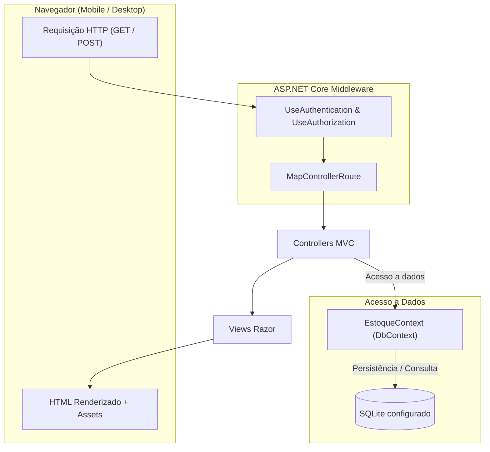

# Documento de Arquitetura de Software — SQUAD

> **Projeto:** Sistema de Controle de Estoque para Varejo de Calçados (SQUAD)  
> **Base Estrutural / Esqueleto:** `SquadEstoque.Web` (ASP.NET Core MVC oficial)  
> **Pilha Tecnológica:** C#, .NET 10, ASP.NET Core MVC, Entity Framework Core, SQLite, Razor Views  

---

## 1. Visão Geral e Princípio Arquitetural

### 1.1 Contexto e Objetivo
O sistema SQUAD é uma ferramenta focada em resolver o problema de chão de loja no varejo de calçados (consulta rápida de estoque pelo vendedor e rastreamento estruturado de rupturas para o lojista).

O projeto usa `SquadEstoque.Web` como base estrutural e tecnológica para o domínio de estoque de calçados.

### 1.2 Princípio de Projeto
> **"Reaproveitar o esqueleto existente e substituir o domínio, não reconstruir o sistema usando uma arquitetura nova."**

A arquitetura é deliberadamente simples, direta e adequada para uma equipe enxuta de quatro desenvolvedores, evitando complexidade acidental ou camadas desnecessárias.

---

## 2. Regras de Contenção Arquitetural

As seguintes restrições regem o desenvolvimento deste projeto:

1. **Padrão Arquitetural**: MVC Tradicional do ASP.NET Core. Não substituir por outras arquiteturas (SPA, Microserviços, Clean Architecture, CQRS, Hexagonal).
2. **Sem Camadas Artificiais**: NÃO criar camadas `Application`, `Domain`, `Infrastructure` ou `Services` sem necessidade concreta e justificada.
3. **Sem Padrões Redundantes**: NÃO introduzir *Repository Pattern* ou *Unit of Work* sobre o Entity Framework Core (o `DbContext` e os `DbSet` já desempenham esses papéis).
4. **Sem DTOs e Interfaces sem Necessidade**: Os Controllers comunicam-se diretamente com o `EstoqueContext` e com as Views através dos Models e ViewModels mínimos necessários para agregação de tela.
5. **Banco de Dados Único**: O banco de dados definido para desenvolvimento e execução é o **SQLite**. Não há previsão de suporte ou migração para PostgreSQL.

---

## 3. Pilha Tecnológica (Tech Stack)

```
┌─────────────────────────────────────────────────────────────┐
│                       SQUAD ESTOQUE                         │
├──────────────────────────────┬──────────────────────────────┤
│ Plataforma & Linguagem       │ .NET 10 / C#                 │
│ Padrão Web                   │ ASP.NET Core MVC             │
│ Motor de Apresentação        │ Razor Views (.cshtml)        │
│ Mapeamento Objeto-Relacional │ Entity Framework Core 10     │
│ Banco de Dados               │ SQLite 3.x (arquivo local)   │
│ Client-side / UI             │ Bootstrap 5, jQuery Validate │
└──────────────────────────────┴──────────────────────────────┘
```

---

## 4. Estrutura de Diretórios e Componentes

A organização mantém o ASP.NET Core MVC tradicional:

| Caminho | Responsabilidade atual |
| --- | --- |
| `Controllers/` | Login, produtos, consulta, movimentações, rupturas, saldos zerados, atendimentos e entrada fiscal. |
| `Models/Entities/` e `Models/ViewModels/` | Nove entidades persistidas e modelos específicos das telas. |
| `Views/` | Telas Razor organizadas por controller e layout compartilhado. |
| `Data/EstoqueContext.cs` | Mapeamento EF Core, relacionamentos, índices e restrições SQLite. |
| `Data/SaidaEstoque.cs` | Baixa de saldo protegida por transação. |
| `Migrations/Estoque/` | Evolução do esquema SQLite. |
| `Program.cs` | Serviços, cookies, pipeline HTTP, migrations e primeiro acesso do LOJISTA. |
| `wwwroot/` | CSS, JavaScript e arquivos estáticos. |

O [modelo vigente](../03-modelagem/README.md) resume as nove tabelas. O banco
em execução é configurado por connection string; o arquivo SQLite local não é
fonte de verdade do projeto. Os [diagramas vigentes](../06-uml/README.md)
mostram as entidades, atores e fluxos atuais.

---

## 5. Fluxo de Execução da Aplicação



---

## 6. Decisões Arquiteturais

### 6.1 Decisões Já Definidas e Aprovadas

| ID | Tópico | Decisão Aprovada | Justificativa |
| :--- | :--- | :--- | :--- |
| **DA-01** | **Esqueleto do Projeto** | O projeto `SquadEstoque.Web` é a base estrutural e tecnológica direta. | Aproveitamento do scaffolding, tooling e configuração já existente e testada. |
| **DA-02** | **SGBD** | **SQLite 3.x** via provedor oficial do EF Core (`Microsoft.EntityFrameworkCore.Sqlite`). | Simplicidade operacional, sem dependência de servidor de banco externo para o MVP. |
| **DA-03** | **Padrão Arquitetural** | **ASP.NET Core MVC tradicional**. | Os controllers acessam o `EstoqueContext` diretamente, sem camadas intermediárias de serviços ou repositórios. |
| **DA-04** | **Unidade Mínima de Estoque (RN-01)** | `Sku` composto por `ProdutoId` + `Numeracao` com constraint única no banco. | Atende estritamente à regra de negócio do varejo de calçados. |
| **DA-05** | **Imutabilidade Operacional (RN-03)** | A tabela `movimentacao` não possui rotas nem lógica de `UPDATE` ou `DELETE`. | Auditoria permanente de entradas, saídas e ajustes de saldo. |
| **DA-06** | **Desacoplamento de Ruptura (RN-05, RN-06)** | A tabela `ruptura` não armazena saldo nem quantidade, sendo gerada exclusivamente pelo clique em "Não tinha". | Ruptura é dado de inteligência comercial, não afeta estoque físico. |
| **DA-07** | **Atomicidade de Venda (RN-07)** | Operações de saída executadas em transação de escrita imediata no SQLite com `CHECK (saldo_atual >= 0)`. | Garante que dois vendedores concorrentes não vendam o último par simultaneamente. |
| **DA-08** | **Autenticação e Sessão** | Cookie Authentication nativo do ASP.NET Core com perfis `VENDEDOR` e `LOJISTA`. | Leve, integrado ao framework e sem a sobrecarga de tabelas do Identity completo. |
| **DA-09** | **Persistência do domínio de estoque** | `EstoqueContext` mapeia as nove tabelas do SQLite; as migrations versionam o esquema. | Uma persistência única para o produto. |

---

### 6.2 Decisões implementadas depois da base inicial

- Senhas de usuários são armazenadas com BCrypt, custo 12.
- Usuários demonstrativos só são criados em `Development` quando
  `Demo:SeedUsers=true` e o banco está vazio. `Testing` usa banco isolado.
- `Production` não cria contas demonstrativas; o primeiro LOJISTA de um banco
  vazio é cadastrado pelo [procedimento operacional](../07-operacional/primeiro-acesso-lojista.md).

---
