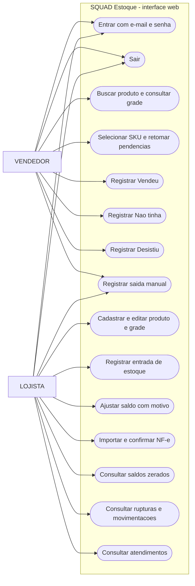

# Casos de uso vigentes

O diagrama mostra as operações disponíveis na interface atual. O `LOJISTA`
gerencia catálogo e estoque; o `VENDEDOR` executa a consulta e o atendimento.
Ambos podem usar a saída manual de estoque. Não existe cadastro público de
usuários nem tela de gestão de contas nesta versão.

O primeiro `LOJISTA` de um banco vazio é criado por um operador com o comando
`--bootstrap-lojista`, somente em `Production`, conforme o
[procedimento operacional](../../07-operacional/primeiro-acesso-lojista.md).
Isso não é um formulário público. As permissões são verificadas no servidor
pelos controllers, além da navegação exibida ao usuário.

Fontes: [requisitos](../../02-requisitos/srs.md),
[`EstoqueController`](../../../src/SquadEstoque.Web/Controllers/EstoqueController.cs),
[`MovimentacoesController`](../../../src/SquadEstoque.Web/Controllers/MovimentacoesController.cs),
[`EntradasFiscaisController`](../../../src/SquadEstoque.Web/Controllers/EntradasFiscaisController.cs)
e [`AtendimentosController`](../../../src/SquadEstoque.Web/Controllers/AtendimentosController.cs).
