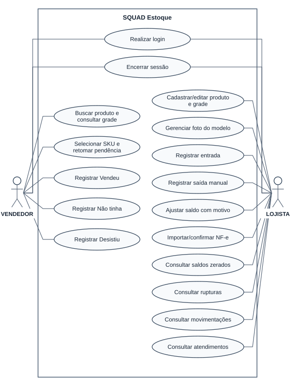

# Diagrama UML de casos de uso vigente

Figura única para o Capítulo 5 da monografia. O [SVG](casos-de-uso-vigentes.svg)
mede 16 × 20,9 cm e pode ser inserido em página A4 retrato. O
[PNG para inserção](casos-de-uso-vigentes.png) foi exportado em 1890 × 2468 px.
O [arquivo-fonte editável](casos-de-uso-vigentes.py) gera a figura com Python 3,
sem dependências externas. As associações representam ações acessíveis aos
atores; não representam a ordem temporal de execução.

**Commit da implementação conferida:** `26f042289596a3785a4624e4ed9a82d2888c0175`.

O `VENDEDOR` busca produtos, consulta a grade, seleciona SKU, retoma pendências
e registra `Vendeu`, `Não tinha` ou `Desistiu`. Selecionar um SKU e retomar uma
pendência são operações distintas. O `LOJISTA` mantém produtos, grades e
imagens; registra entradas, saídas manuais e ajustes; importa XML de NF-e e,
após a conferência, confirma a entrada fiscal em operação distinta. Também
consulta saldos zerados e os históricos de rupturas,
movimentações e atendimentos. Ambos podem entrar e encerrar a sessão.

Geração automática de SKU, atualização de saldo e criação de movimentação ou
ruptura são comportamentos internos dos casos representados, não atores
externos. A figura não usa `include` ou `extend`, pois essas relações não são
necessárias para expressar as interações selecionadas. O primeiro `LOJISTA` de
um banco vazio é criado por operador via `--bootstrap-lojista` em `Production`,
conforme o [procedimento operacional](../../07-operacional/primeiro-acesso-lojista.md);
não há cadastro público de usuários.

Fontes de verificação: [SRS](../../02-requisitos/srs.md),
[casos de uso textuais](../../02-requisitos/casos-de-uso.md),
[controllers](../../../src/SquadEstoque.Web/Controllers/),
[views](../../../src/SquadEstoque.Web/Views/) e
[validação funcional publicada](../../09-testing/execucoes/sprint-4/s4-qa-019-validacao-final-producao.md).
