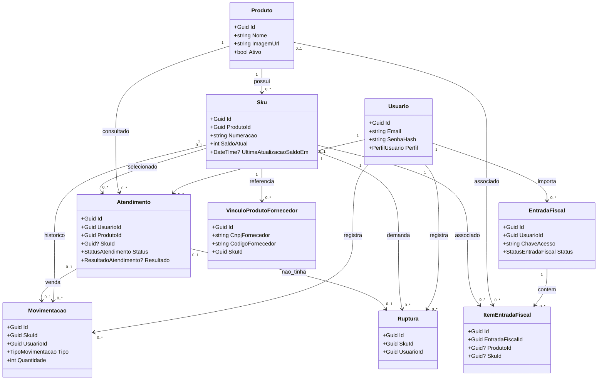

# Diagrama de classes vigente

Resumo das nove entidades C# persistidas. Os atributos listados são os que
explicam os vínculos e regras; consulte os [models](../../../src/SquadEstoque.Web/Models/Entities/)
para a definição completa.

`Sku.UltimaAtualizacaoSaldoEm`, `Produto.ImagemUrl`, `Atendimento.SkuId` e
`Atendimento.Resultado`, `ItemEntradaFiscal.ProdutoId` e
`ItemEntradaFiscal.SkuId` podem ser nulos. Os vínculos de `Movimentacao` e
`Ruptura` com `Atendimento` também são opcionais. Os tipos CLR exibidos aqui
não são tipos físicos do SQLite; veja o [DER vigente](../der-fisico/der-vigente.md).
