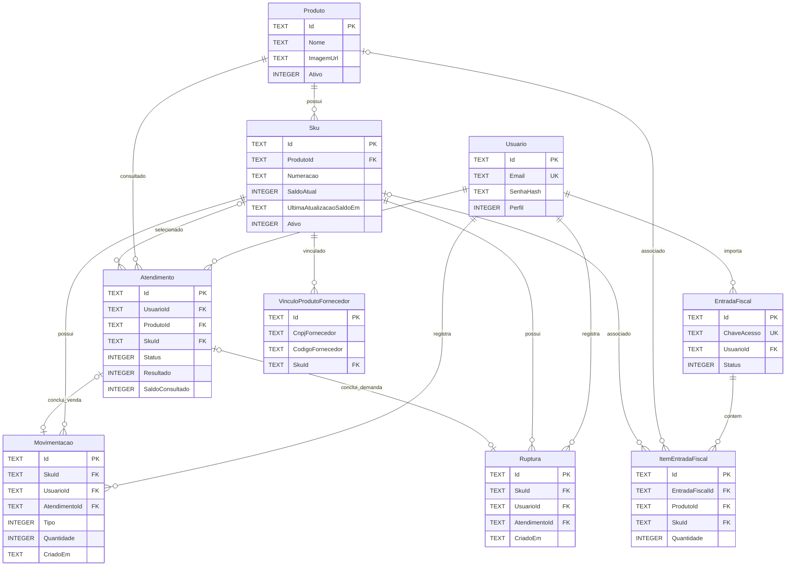

# DER vigente — SQLite

Este diagrama representa as nove entidades persistidas em 10/11/2026. Exibe as
colunas relevantes aos relacionamentos e regras principais, sem repetir o
[`EstoqueContext`](../../../src/SquadEstoque.Web/Data/EstoqueContext.cs) e o
[`ModelSnapshot`](../../../src/SquadEstoque.Web/Migrations/Estoque/EstoqueContextModelSnapshot.cs)
inteiros. `TEXT` e `INTEGER` indicam as representações usadas no SQLite.

`Atendimento.SkuId`, `Movimentacao.AtendimentoId`, `Ruptura.AtendimentoId`,
`ItemEntradaFiscal.ProdutoId` e `ItemEntradaFiscal.SkuId` são opcionais. Os
vínculos de `Movimentacao` e `Ruptura` com `Atendimento` são únicos quando
presentes. A exclusão de `ItemEntradaFiscal` acompanha a de `EntradaFiscal`;
os demais vínculos configurados no contexto usam deleção restritiva.

Restrições centrais: `Sku(ProdutoId, Numeracao)` único, `SaldoAtual >= 0`,
`Usuario.Email` único, `Movimentacao.Quantidade > 0`,
`EntradaFiscal.ChaveAcesso` única e
`VinculoProdutoFornecedor(CnpjFornecedor, CodigoFornecedor)` único. O contexto
também valida os estados de `Atendimento` por `CHECK` e define índices de
consulta. O [DER anterior](DER-fisico.md) é um registro histórico de cinco
tabelas.
