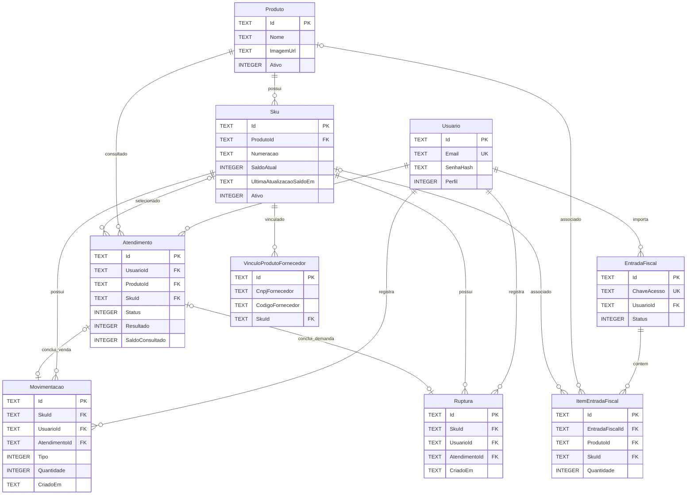

# DER vigente — SQLite

O diagrama integral abaixo representa as nove entidades persistidas em 10/11/2026. Exibe as
colunas relevantes aos relacionamentos e regras principais, sem repetir o
[`EstoqueContext`](../../../src/SquadEstoque.Web/Data/EstoqueContext.cs) e o
[`ModelSnapshot`](../../../src/SquadEstoque.Web/Migrations/Estoque/EstoqueContextModelSnapshot.cs)
inteiros. `TEXT` e `INTEGER` indicam as representações usadas no SQLite.

## Visões para a documentação acadêmica

Na monografia, o DER físico é apresentado em duas visões complementares para
manter os campos e as cardinalidades legíveis em A4 retrato. A visão de
**catálogo e atendimento** contém dez relacionamentos; a de **entrada fiscal**,
cinco. `Usuario`, `Produto` e `Sku` aparecem nas duas figuras apenas para dar
contexto aos vínculos. Juntas, elas representam as mesmas nove entidades e os
quinze relacionamentos do diagrama integral, mantido abaixo como referência
técnica.

### Catálogo e atendimento

[Fonte Mermaid editável](der-catalogo-atendimento.mmd) · [SVG](der-catalogo-atendimento.svg)

### Entrada fiscal

[Fonte Mermaid editável](der-entrada-fiscal.mmd) · [SVG](der-entrada-fiscal.svg)

## Visão integral do esquema

`Atendimento.SkuId`, `Movimentacao.AtendimentoId`, `Ruptura.AtendimentoId`,
`ItemEntradaFiscal.ProdutoId` e `ItemEntradaFiscal.SkuId` são opcionais. Os
vínculos de `Movimentacao` e `Ruptura` com `Atendimento` são únicos quando
presentes. A exclusão de `ItemEntradaFiscal` acompanha a de `EntradaFiscal`;
os demais vínculos configurados no contexto usam deleção restritiva.

Restrições centrais: `Sku(ProdutoId, Numeracao)` único, `SaldoAtual >= 0`,
`Usuario.Email` único, `Movimentacao.Quantidade > 0`,
`EntradaFiscal.ChaveAcesso` única e
`VinculoProdutoFornecedor(CnpjFornecedor, CodigoFornecedor)` único. O contexto
também valida os estados de `Atendimento` por `CHECK` e define índices de
consulta. O [modelo físico acadêmico inicial](../../03-modelagem/modelo_fisico.md)
é um registro histórico de cinco tabelas e não descreve o esquema atual.
