# DER físico vigente — SQLite

As duas visões abaixo representam, em conjunto, as **nove tabelas e quinze
relacionamentos** configurados em `EstoqueContext` e confirmados no
`EstoqueContextModelSnapshot`. `Usuario`, `Produto` e `Sku` repetem-se
como contexto visual; não são tabelas duplicadas. A seleção de colunas prioriza
chaves e atributos relevantes para a monografia. O esquema completo permanece
nas migrations e no ModelSnapshot.

**Implementação de referência:** commit
`26f042289596a3785a4624e4ed9a82d2888c0175`.

| Visão | Relacionamentos | Fonte da figura | SVG | PNG |
| --- | ---: | --- | --- | --- |
| Catálogo e atendimento | 10 | [Graphviz DOT](der-catalogo-atendimento.dot) | [Figura](der-catalogo-atendimento.svg) | [Imagem](der-catalogo-atendimento.png) |
| Entrada fiscal | 5 | [Mermaid](der-entrada-fiscal.mmd) | [Figura](der-entrada-fiscal.svg) | [Imagem](der-entrada-fiscal.png) |

A [fonte Mermaid equivalente do catálogo](der-catalogo-atendimento.mmd)
permanece editável para conferência estrutural. Sua renderização automática
ficou alta demais para A4 retrato; por isso a figura definitiva foi organizada
em Graphviz DOT. As duas fontes descrevem as mesmas tabelas, colunas e
cardinalidades. O DOT omite apenas os verbos das associações na imagem; os
vínculos são identificados pelas tabelas conectadas, FKs e cardinalidades.

## Convenções

`TEXT` e `INTEGER` indicam os **tipos físicos SQLite** confirmados no
ModelSnapshot. Em particular, `Guid` e `DateTime` C# são armazenados como
`TEXT`, e enums e booleanos como `INTEGER`. `PK` e `FK` identificam
chaves; índices únicos compostos são descritos abaixo. Todos os relacionamentos
são **não identificadores**, por isso as linhas das figuras são tracejadas: nenhuma
FK integra a PK da tabela dependente. A cardinalidade é indicada pelas
extremidades; ela não especifica a regra de exclusão.

As FKs `Atendimento.SkuId`, `Movimentacao.AtendimentoId`,
`Ruptura.AtendimentoId`, `ItemEntradaFiscal.ProdutoId` e
`ItemEntradaFiscal.SkuId` aceitam `NULL`. As outras FKs representadas são
obrigatórias. `Atendimento.Resultado`, `Atendimento.SaldoConsultado` e
`Sku.UltimaAtualizacaoSaldoEm` também aceitam `NULL`. As duas associações
com `Atendimento` são opcionais nas duas pontas, com no máximo um vínculo por
movimentação ou ruptura.

| Associação pela FK | Cardinalidade da tabela principal → dependente |
| --- | --- |
| `Sku.ProdutoId` | `Produto` 1 → 0..N `Sku` |
| `Atendimento.UsuarioId` | `Usuario` 1 → 0..N `Atendimento` |
| `Movimentacao.UsuarioId` | `Usuario` 1 → 0..N `Movimentacao` |
| `Ruptura.UsuarioId` | `Usuario` 1 → 0..N `Ruptura` |
| `Atendimento.ProdutoId` | `Produto` 1 → 0..N `Atendimento` |
| `Atendimento.SkuId` | `Sku` 0..1 → 0..N `Atendimento` |
| `Movimentacao.SkuId` | `Sku` 1 → 0..N `Movimentacao` |
| `Ruptura.SkuId` | `Sku` 1 → 0..N `Ruptura` |
| `Movimentacao.AtendimentoId` | `Atendimento` 0..1 → 0..1 `Movimentacao` |
| `Ruptura.AtendimentoId` | `Atendimento` 0..1 → 0..1 `Ruptura` |
| `EntradaFiscal.UsuarioId` | `Usuario` 1 → 0..N `EntradaFiscal` |
| `ItemEntradaFiscal.EntradaFiscalId` | `EntradaFiscal` 1 → 0..N `ItemEntradaFiscal` |
| `ItemEntradaFiscal.ProdutoId` | `Produto` 0..1 → 0..N `ItemEntradaFiscal` |
| `ItemEntradaFiscal.SkuId` | `Sku` 0..1 → 0..N `ItemEntradaFiscal` |
| `VinculoProdutoFornecedor.SkuId` | `Sku` 1 → 0..N `VinculoProdutoFornecedor` |

## Restrições físicas e exclusão

- Índices únicos: `Usuario(Email)`, `Sku(ProdutoId, Numeracao)`,
  `EntradaFiscal(ChaveAcesso)` e
  `VinculoProdutoFornecedor(CnpjFornecedor, CodigoFornecedor)`.
- Índices únicos em `Movimentacao(AtendimentoId)` e
  `Ruptura(AtendimentoId)`; no SQLite, múltiplos `NULL` são admitidos.
- `CHECK`: `Sku.SaldoAtual >= 0`,
  `Movimentacao.Quantidade > 0`, domínios de
  `Usuario.Perfil`, `Movimentacao.Tipo`, `Atendimento.Status` e
  `Atendimento.Resultado`, além das condições de saldo, conclusão e vínculo
  entre SKU e resultado de `Atendimento`.
- A FK `ItemEntradaFiscal.EntradaFiscalId` utiliza `CASCADE`. As outras
  FKs configuradas utilizam `RESTRICT`.

As duas figuras cabem na área de 16 cm de largura da página A4 retrato:
catálogo com aproximadamente 16 × 16,8 cm e entrada fiscal com 16 × 17,7 cm.

As regras de imutabilidade do histórico dependem das operações da aplicação;
o DER não atribui essa garantia a uma constraint SQLite inexistente. O
[modelo físico acadêmico inicial](../../03-modelagem/modelo_fisico.md) é
histórico e não descreve o esquema vigente.

**Fontes técnicas:**
[entidades](../../../src/SquadEstoque.Web/Models/Entities/),
[EstoqueContext](../../../src/SquadEstoque.Web/Data/EstoqueContext.cs),
[ModelSnapshot](../../../src/SquadEstoque.Web/Migrations/Estoque/EstoqueContextModelSnapshot.cs),
[migrations](../../../src/SquadEstoque.Web/Migrations/Estoque/) e
[SRS](../../02-requisitos/srs.md).
