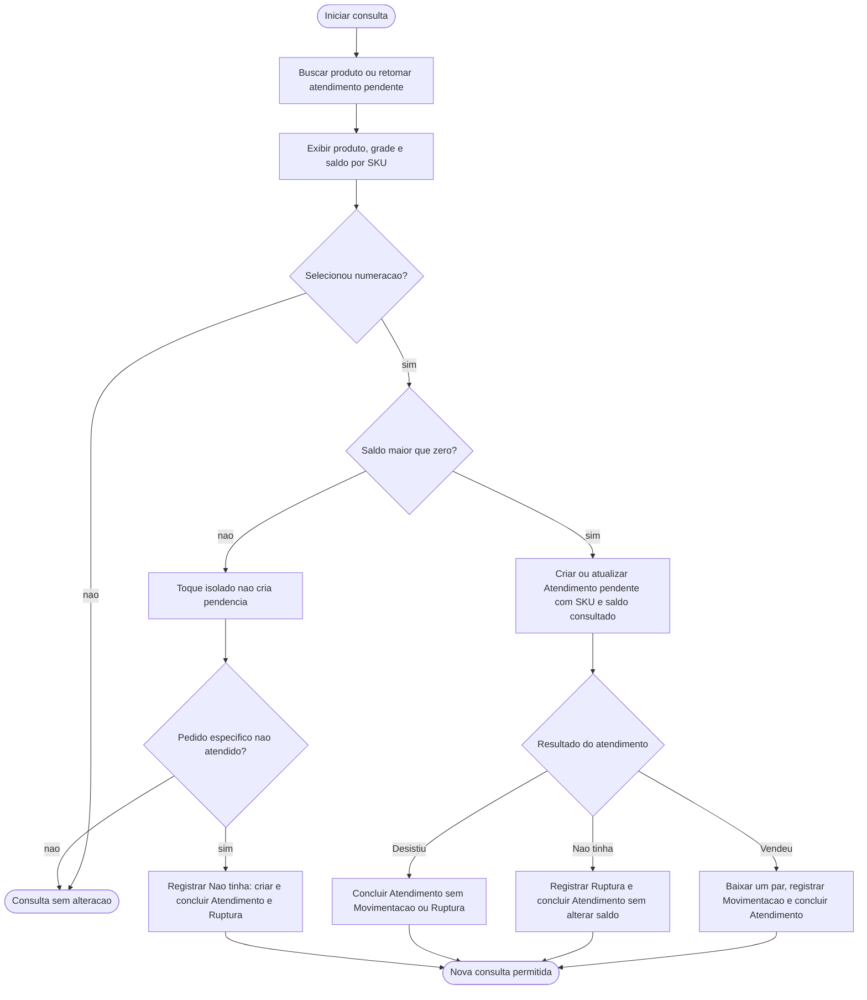
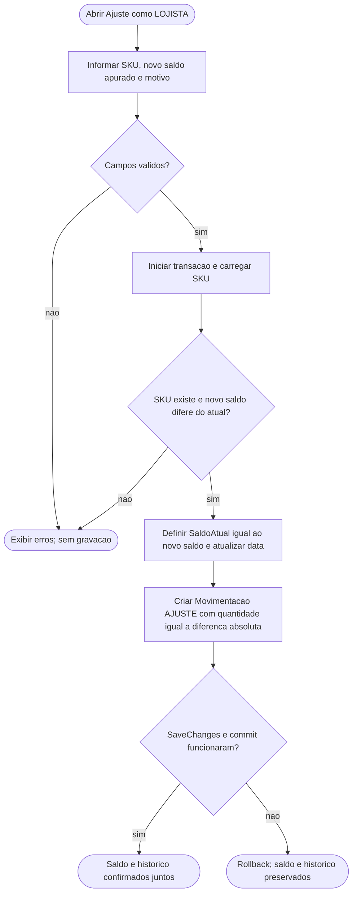
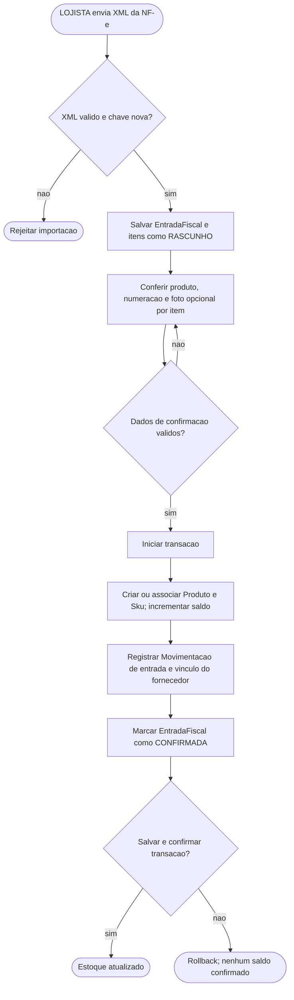
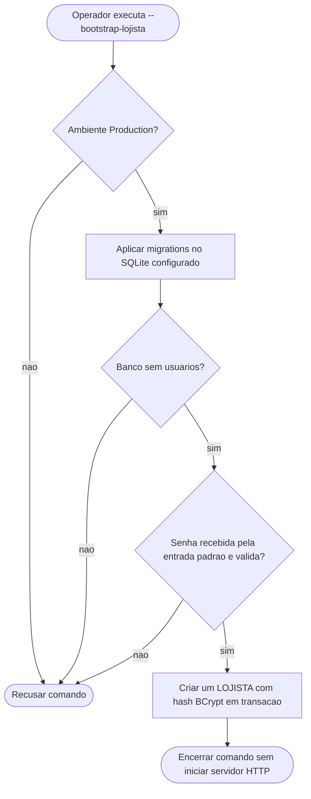

# Fluxos vigentes

Os fluxos resumem as decisões observáveis do código. Cada gravação é validada
novamente no servidor; as telas não definem a autorização ou o saldo persistido.

## Consulta e atendimento do VENDEDOR

O vendedor pode ter vários atendimentos pendentes. A retomada carrega somente
o produto e o SKU daquele atendimento. As operações `Vendeu`, `Não tinha` e
`Desistiu` são implementadas em
[`EstoqueController`](../../../src/SquadEstoque.Web/Controllers/EstoqueController.cs).

## Ajuste manual do LOJISTA

O novo saldo deve ser não negativo. O motivo é obrigatório. O formulário e a
ação exigem `LOJISTA`; a quantidade da movimentação não tem sinal. Veja
[`MovimentacoesController.Ajuste`](../../../src/SquadEstoque.Web/Controllers/MovimentacoesController.cs).

## Entrada por XML de NF-e

O rascunho não altera o estoque; a confirmação usa uma transação. A chave de
acesso única impede importar a mesma NF-e novamente. Veja
[`EntradasFiscaisController`](../../../src/SquadEstoque.Web/Controllers/EntradasFiscaisController.cs).

## Primeiro acesso do LOJISTA

A senha não é passada em argumento ou variável de ambiente. O comando não
remove usuários antigos e não cria `VENDEDOR`. Consulte o
[procedimento de primeiro acesso](../../07-operacional/primeiro-acesso-lojista.md).
