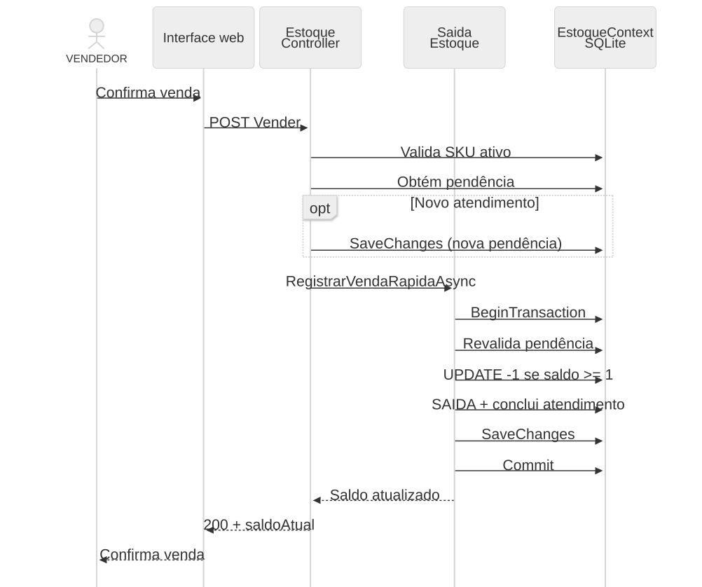

# Diagrama de sequência vigente — venda de um par

Esta é a única figura de sequência vigente para o Capítulo 5 da monografia.
O [SVG](sequencia-venda.svg) apresenta o cenário de venda bem-sucedida e a
[fonte Mermaid editável](sequencia-venda.mmd) permite regenerá-lo. A figura foi
preparada para inserção em A4 retrato com largura de até 16 cm. O
[PNG](sequencia-venda.png) tem 1890 × 1638 px.

**Commit da implementação conferida:** `26f042289596a3785a4624e4ed9a82d2888c0175`.

O VENDEDOR confirma `Vendeu` na interface web, que envia `POST /Estoque/Vender`
ao `EstoqueController`. O controller valida o SKU e obtém o atendimento
pendente. Quando é necessário criar uma nova pendência, ela pode ser salva
**antes** do início da transação de saída; o bloco `opt` representa apenas essa
possibilidade.

`SaidaEstoque.RegistrarVendaRapidaAsync` inicia a transação, revalida o
atendimento pendente e executa a atualização condicional do saldo. No caminho
de sucesso, prepara a movimentação `SAIDA`, marca o atendimento como concluído
com resultado `VENDEU`, chama `SaveChangesAsync` e confirma a transação com
`CommitAsync`. O controller devolve o saldo persistido, e a interface atualiza
a grade e confirma a venda.

Os caminhos de atendimento inválido, saldo insuficiente e conflito de
concorrência não são desenhados nesta figura. O código trata esses resultados
sem confirmar a saída. Uma pendência criada antes da transação pode permanecer
registrada mesmo quando a venda não é concluída; a figura não atribui essa
criação à transação de saída.

Fontes: [`EstoqueController.Vender`](../../../src/SquadEstoque.Web/Controllers/EstoqueController.cs),
[`SaidaEstoque`](../../../src/SquadEstoque.Web/Data/SaidaEstoque.cs),
[`EstoqueContext`](../../../src/SquadEstoque.Web/Data/EstoqueContext.cs),
[`consulta.js`](../../../src/SquadEstoque.Web/wwwroot/js/consulta.js) e
[SRS, RN-02 e RN-07 a RN-09](../../02-requisitos/srs.md).
