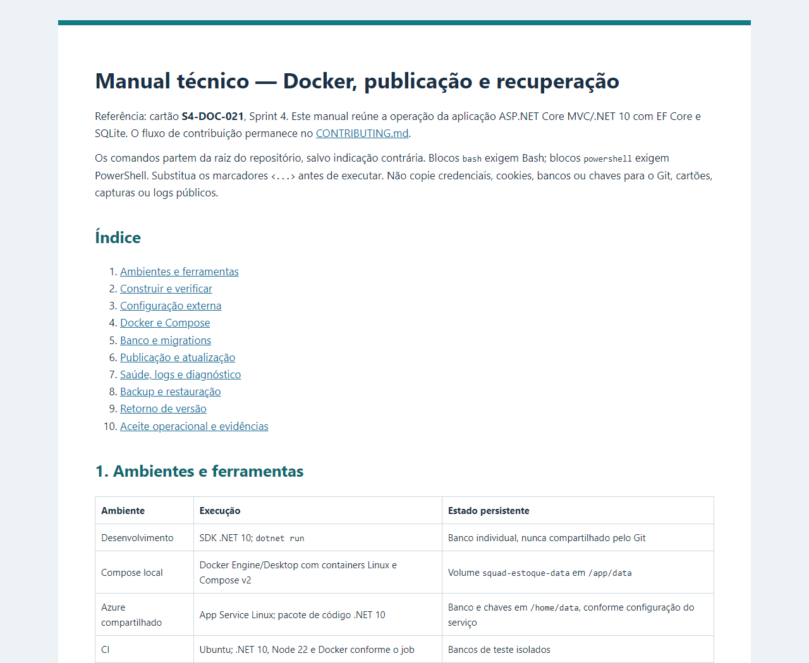

# S4-DOC-021 — Verificação do manual técnico

Data: **21/11/2026**, America/Sao_Paulo. Base consultada:
`0f6d52d4cfa19b0736a32338f4c09dcfe2078400`, da `main`.
Entrega: [manual-tecnico.md](manual-tecnico.md).

## Método e fontes

Foram conferidos `README.md`, `CONTRIBUTING.md`, Dockerfile, Compose,
`.dockerignore`, configuração e startup da aplicação, migrations, scripts de
recuperação, workflows e os guias operacionais vinculados no manual. A mudança
é documental; nenhum código, migration, banco, workflow ou recurso Azure foi
alterado. Os comandos locais usam banco de teste ou fixture descartável.

O repositório respondeu com nome canônico `CodeWitch00/SQUAD-estoque`. O remoto
local antigo `CodeWitch00/ESTOQUE` ainda redireciona para ele. Os links novos
usam o nome confirmado pela API do GitHub.

## Validação local

Ambiente: Windows, SDK .NET **10.0.401**. Comandos executados na raiz:

```text
dotnet restore tests/SquadEstoque.Web.Tests/SquadEstoque.Web.Tests.csproj --ignore-failed-sources
dotnet build tests/SquadEstoque.Web.Tests/SquadEstoque.Web.Tests.csproj -c Release --no-restore
dotnet publish src/SquadEstoque.Web/SquadEstoque.Web.csproj --configuration Release --no-restore --output publish/manual-tecnico
```

Restore, build e publish concluídos. O build teve zero erros e dois avisos
NU1900: o ambiente isolado não conseguiu consultar a fonte de vulnerabilidades
do NuGet. Isso não constitui auditoria de segurança aprovada. O pacote gerado
é somente local; não foi enviado ao Azure.

O primeiro `dotnet test` foi abortado porque `vstest` não conseguiu estabelecer
comunicação local com `testhost` em 90 segundos. A repetição foi executada fora
do isolamento, com o mesmo build; o resultado final está registrado abaixo.

```text
dotnet test tests/SquadEstoque.Web.Tests/SquadEstoque.Web.Tests.csproj -c Release --no-build
Aprovado: 379; com falha: 0; ignorado: 1; total: 380; duração: 22 s.
```

O teste ignorado é `ConsultaP95Tests.RNF02_consulta_p95_must_be_below_500ms`,
já marcado como ignorado na base. A execução não comprova o requisito P95.
O resultado TRX foi preservado na área temporária local. A pasta de publish
contém a DLL esperada e não contém arquivos `.db`, `.sqlite` ou `.sqlite3`.

### Backup e restauração repetidos nesta entrega

Ferramenta: SQLite **3.54.1**, pacote portátil oficial disponível na
[página de downloads do SQLite](https://www.sqlite.org/download.html), usado
somente na área temporária do workspace. O SHA3-256 do ZIP foi conferido contra
o valor publicado: `e171f3993a992edf076746926dd52b5e2ebfabaee38818e74987e1d8112ab987`.
Execução: Git Bash no Windows, com `SQLITE3_BIN` apontando para `sqlite3.exe`.

```bash
bash scripts/test-sqlite-recovery.sh
```

Saída observada em **21/11/2026, 15:48:41 -03:00** (caminho temporário omitido):

```text
sqlite3_version=3.54.1
fixture_produto_id=11111111-1111-4111-8111-111111111111
backup_criado=Estoque-Testing-20261121T184841Z.sqlite3
integrity_check=ok
foreign_key_check=ok
produto_conhecido=presente (11111111-1111-4111-8111-111111111111)
dado_conhecido_restaurado=Produto conhecido de teste
destino_existente_sobrescrito=nao
resultado=APROVADO (backup e restauração isolada da fixture)
```

O script criou a fixture, fez `.backup`, restaurou para arquivo novo, verificou
o dado conhecido e recusou sobrescrever o destino existente. Não foi usado
nenhum banco real. Essa evidência complementa a
[execução histórica de 15/11](validacao-backup-restauracao.md).

## Docker/Ubuntu e estado da main

Docker não está instalado neste host e WSL não está instalado. O build do
container e a persistência foram conferidos pelo job **sqlite-volume**, aprovado
em Ubuntu para o mesmo SHA base, na
[execução 44915325136](https://github.com/CodeWitch00/SQUAD-estoque/actions/runs/44915325136).
O job executa `bash scripts/test-sqlite-volume.sh` e publica o log como artefato.
Isso não é uma execução de Docker Desktop no Windows.

Na mesma execução da `main`:

| Job | Resultado observado |
| --- | --- |
| `build-and-test` | Aprovado, incluindo cobertura |
| `sqlite-volume` | Aprovado |
| `frontend-tests` | Aprovado |
| `deploy-azure` | Falhou em **Check application health**, depois de **Deploy to App Service** ter passado |

Logo, essa execução da `main` **não está totalmente verde**. A falha já existia
antes desta alteração documental; não foi corrigida ou reexecutada como parte
do cartão. A variável de repositório `AZURE_CD_ENABLED` foi consultada e estava
`true`. Nenhum secret foi lido.

## Conferência pública do ambiente hospedado

Foi executado `curl.exe --silent --show-error --max-time 45 -D -` contra a URL
pública `/health` indicada em `README.md`. Resposta em
**21/11/2026, 15:46:46 -03:00**, com validação TLS habilitada:

```text
HTTP/1.1 200 OK
Content-Type: text/plain
Date: Sat, 21 Nov 2026 18:46:46 GMT
Server: Kestrel
Cache-Control: no-store, no-cache

Healthy
```

Esse resultado posterior não apaga a falha do deploy e não identifica sozinho
o SHA que está atendendo. Não houve sessão administrativa Azure disponível
nesta execução: configuração efetiva, logs privados, reinício, republicação e
restauração da cópia real não foram validados aqui.

## Divergências registradas para decisão

| Fontes | Divergência e tratamento |
| --- | --- |
| Cartão versus `CONTRIBUTING.md` §4.2 | Cartão pede branch própria; guia exige `dev/felipe`. Felipe autorizou explicitamente manter `docs/s4-doc-021-felipe` para esta entrega. |
| `CONTRIBUTING.md` §§7–8 versus `dotnet.yml` e `azure.md` | Guia diz que CI não publica e que CD será configurado depois; workflow contém deploy e variável consultada está ativa. Manual descreve o código/estado observado; nenhuma política ou configuração foi alterada. |
| `azure.md` versus relatório S4-QA-019 | Runbook marca login dos perfis como pendente; [relatório de 19/11](../09-testing/execucoes/sprint-4/s4-qa-019-validacao-final-producao.md) relata testes funcionais publicados. São registros de datas diferentes; o manual não os converte em aceite atual nem em prova de recuperação. |
| `.env.compose.example` versus `Program.cs` | Comentário sugere seed em demonstração Production, mas código nunca executa seed nesse ambiente; manual explicita o comportamento real. |
| Persistência SQLite versus uploads | Volume atual cobre banco/chaves, não fotos. O limite foi documentado; não foi criada montagem nova. |

## Critérios e pendências de encerramento

Os links locais e âncoras dos dois documentos foram conferidos; os blocos de
código estão fechados e `git diff --check` passou. A captura abaixo mostra a
renderização local da abertura e do índice do manual, conferida visualmente.
Ela comprova a apresentação da documentação, não a operação do Azure.



- [x] Manual técnico versionável, com índice e links para procedimentos existentes.
- [x] Pré-requisitos, Docker/Compose, variáveis sem segredos e migrations conferidos no código.
- [x] Publicação, saúde, logs, atualização e retorno de versão documentados.
- [x] Backup/restauração testados com fixture, com limites explícitos.
- [ ] Conferência administrativa dos comandos no ambiente hospedado e restauração da cópia real em isolamento.
- [ ] Revisão por outro integrante/mantenedora e incorporação das correções solicitadas.
- [ ] Aprovação, merge e validação integrada.
- [ ] Atualização das evidências/checklist do cartão, conforme autorização específica de governança.

O cartão não pode ser declarado concluído apenas com esta documentação.
Nenhum cartão foi aberto ou modificado nesta execução. A revisão técnica pelo
autor não substitui a revisão por outro integrante.
