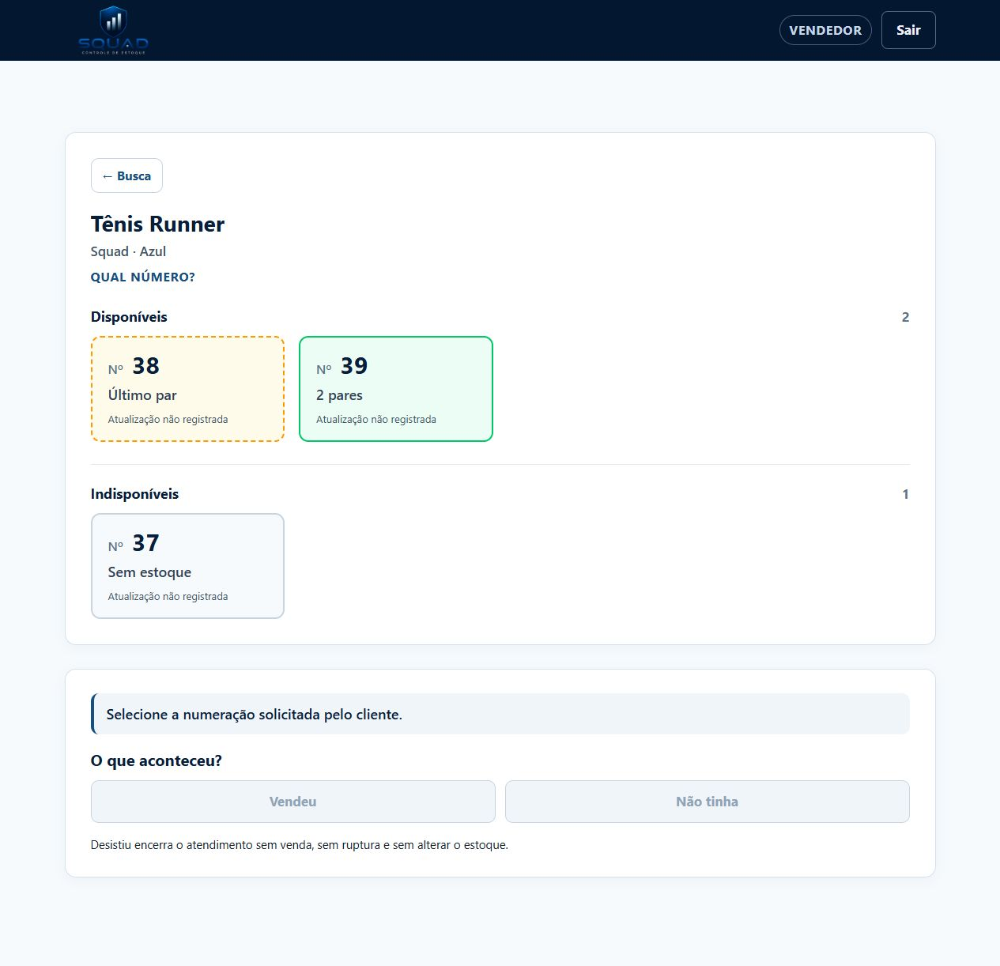
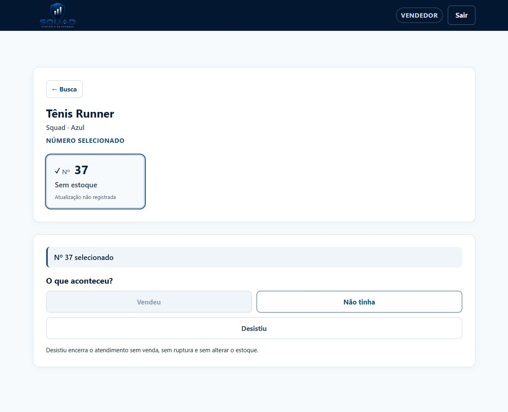
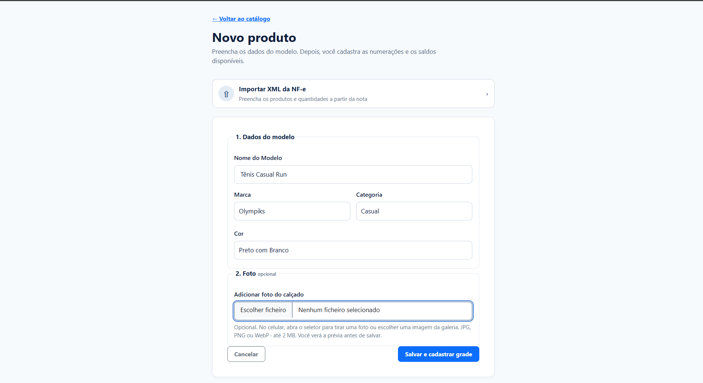
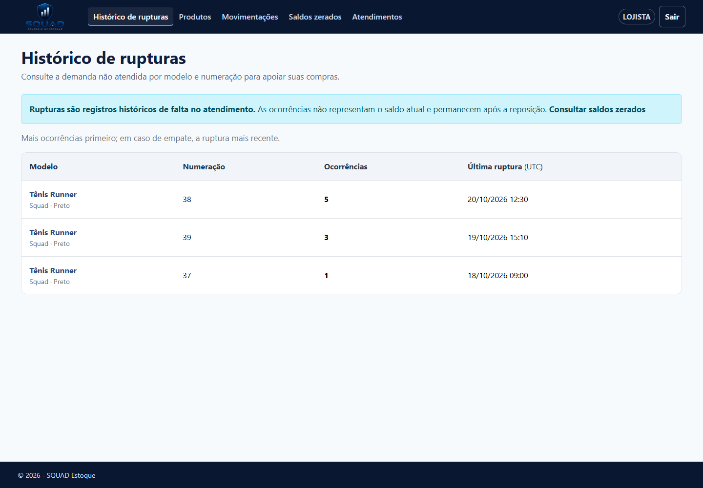

# Manual do usuário — SQUAD Estoque

> Este manual descreve os caminhos visíveis na implementação indicada acima. Antes de usar o PDF como manual final, confira cada passo na versão publicada e substitua as capturas históricas por capturas dessa versão, com dados fictícios.

## Sumário

1. [Acesso e perfis](#1-acesso-e-perfis)
2. [VENDEDOR: consulta e atendimento](#2-vendedor-consulta-e-atendimento)
3. [LOJISTA: catálogo e cadastro](#3-lojista-catálogo-e-cadastro)
4. [LOJISTA: estoque e históricos](#4-lojista-estoque-e-históricos)
5. [Conferência antes do aceite](#5-conferência-antes-do-aceite)

## 1. Acesso e perfis

1. Abra o endereço do sistema fornecido pela equipe. Na tela **Bem-vindo**, informe seu e-mail e sua senha. Marque **Lembrar-me** somente em dispositivo de uso pessoal.
2. Selecione **Entrar**. O VENDEDOR chega à consulta de estoque; o LOJISTA chega ao catálogo de produtos.
3. Ao terminar, selecione **Sair** no cabeçalho. Em celular, abra o menu pelo botão **Alternar navegação** se necessário.

Se aparecer **“E-mail ou senha inválidos.”**, confira os dados e tente novamente. Se aparecer **Acesso negado**, volte ao início do seu perfil; peça à pessoa responsável que confira sua permissão se precisar daquela função.

| Perfil             | Tarefas pelo menu                                                                                                                                                                          |
| ------------------ | ------------------------------------------------------------------------------------------------------------------------------------------------------------------------------------------ |
| **VENDEDOR** | Consultar modelo e numeração; registrar **Vendeu**, **Não tinha** ou **Desistiu**; retomar atendimentos pendentes.                                                    |
| **LOJISTA**  | Produtos e cadastro; entradas, saídas e ajustes; histórico de movimentações; saldos zerados; histórico de rupturas; atendimentos. A importação de NF-e fica no cadastro de produto. |

Um **SKU** identifica um produto e uma numeração. O saldo mostrado é desse par, não do modelo inteiro.

## 2. VENDEDOR: consulta e atendimento

### Encontrar o modelo

1. Na tela **Qual modelo o cliente procura?**, digite ao menos dois caracteres do nome e selecione **Buscar**.
2. Escolha o modelo nos resultados. Confira nome, marca e cor. Na grade, selecione a numeração pedida pelo cliente.
3. Leia o saldo da numeração: **Último par**, quantidade em pares ou **Sem estoque**. A tela também mostra a data da última atualização, quando registrada.

Com menos de dois caracteres, a tela pede **“Digite pelo menos 2 caracteres para buscar.”**. Se nenhum modelo corresponder, mostra **“Produto não encontrado.”**; tente parte diferente do nome.

*Exemplo de teste local. Fonte: `docs/09-testing/evidencias/consulta-otimizada/grade.png`. Conferir novamente na publicação antes do aceite.*

### Registrar o resultado

- **Vendeu:** selecione uma numeração com saldo disponível e toque em **Vendeu**. A ação registra a venda de um par e atualiza o saldo. Confira a mensagem de retorno antes de iniciar outra consulta.
- **Não tinha:** selecione a numeração solicitada e toque em **Não tinha** quando não foi possível atender o pedido. Isso registra uma ruptura e não reduz o saldo.
- **Desistiu:** use quando o cliente desistir. O atendimento é encerrado sem venda, sem ruptura e sem mudança no estoque.

Se voltar à busca antes de informar o resultado, o atendimento pode permanecer em **Atendimentos pendentes**. Abra **Retomar** para concluí-lo. Se a venda não for aceita porque o saldo mudou ou a numeração ficou indisponível, consulte a grade atualizada e não repita o envio sem verificar o resultado.

*Exemplo de teste local: retomada. Fonte: `docs/09-testing/evidencias/consulta-otimizada/retomada.png`.*

## 3. LOJISTA: catálogo e cadastro

### Consultar produtos

No menu **Produtos**, busque ou filtre o catálogo. Abra **Detalhes** para ver as numerações, os saldos e as ações de estoque. Se os filtros retornarem **“Nenhum produto encontrado”**, selecione **Limpar filtros**.

### Cadastrar produto e grade

1. Em **Produtos**, selecione **Cadastro Produto**. Informe nome do modelo, marca, categoria e cor. A foto é opcional: JPG, PNG ou WebP de até 2 MB.
2. Selecione **Salvar e cadastrar grade**. Escolha as numerações e informe a quantidade em estoque de cada uma. Pode adicionar outras numerações no campo próprio.
3. Salve a grade e confira os SKUs nos detalhes do produto. Se uma numeração já existir ou for repetida, corrija a seleção antes de enviar novamente.

Nos detalhes, **Editar produto** altera os dados do modelo; **Adicionar numeração** amplia a grade. Há também a opção **Importar XML da NF-e** no cadastro: selecione o XML autorizado, confira modelo, numeração e quantidade e confirme. O estoque só muda depois da confirmação da conferência.

*Exemplo de teste anterior: cadastro. Fonte: evidência S2-QA-035; conferir novamente na publicação.*

## 4. LOJISTA: estoque e históricos

### Entrada, saída e ajuste

Em **Movimentações**, escolha **Nova entrada**, **Nova saída** ou **Ajuste manual**. Também é possível abrir a ação a partir do SKU em **Produtos → Detalhes**.

- **Entrada:** selecione produto e numeração, informe a quantidade recebida (pelo menos um par), acrescente uma observação se desejar e confirme.
- **Saída:** selecione produto e numeração, informe a quantidade retirada (pelo menos um par) e confirme. O sistema não deve concluir uma saída que deixaria o saldo negativo.
- **Ajuste manual:** após a contagem física, informe o novo saldo real, igual ou maior que zero, e uma justificativa de pelo menos cinco caracteres. O novo valor precisa ser diferente do saldo atual.

Confira o saldo atualizado nos detalhes e o registro em **Movimentações**. Se o ajuste mostrar **“Não há alteração de saldo a ser registrada.”**, confira o valor informado. Se o saldo tiver sido alterado por outra operação, atualize a tela antes de tentar de novo.

### Consultar históricos e reposição

- **Movimentações:** filtre por produto, tipo, período ou responsável. A tabela mostra data e hora, numeração, quantidade e motivo ou observação. Registros anteriores permanecem no histórico.
- **Saldos zerados:** mostra numerações sem saldo no momento, agrupadas por produto.
- **Histórico de rupturas:** mostra ocorrências de **Não tinha** por modelo e numeração. Uma ruptura permanece no histórico mesmo depois da reposição; ela não representa o saldo atual. A data da última ruptura aparece em UTC.
- **Atendimentos:** mostra pendentes, concluídos e alertas para revisão, com vendedor, modelo, numeração e resultado.

*Exemplo de teste local: histórico de rupturas. Fonte: evidência de 20/10/2026; conferir novamente na publicação.*

## 5. Conferência antes do aceite

Este arquivo foi preparado a partir do código do commit indicado. Para fechar a S4-DOC-020, uma pessoa que não escreveu o manual deve executar os passos dos dois perfis na versão publicada, conferir as mensagens e substituir as imagens históricas por capturas atuais com dados fictícios. Registre nome, data, endereço ou ambiente, versão publicada, navegador, resultado de cada fluxo e correções feitas. Gere novamente o PDF e anexe-o diretamente ao cartão Trello.

**Divergência registrada:** a saída administrativa aparece no menu do LOJISTA, mas a rota de Saída no código também aceita o papel VENDEDOR. Este manual apresenta o fluxo de atendimento do vendedor e não orienta o uso dessa rota administrativa. A equipe deve decidir e corrigir a permissão em tarefa própria.
