# S2-QA-035 — Validação de navegação por perfil: Desktop e Mobile

## 1. Identificação

| Campo | Valor |
|---|---|
| Projeto | SQUAD Estoque |
| Card | [S2-QA-035] Validar navegação por perfil — mobile e desktop sem acesso indevido |
| Sprint | 2 |
| Área | Garantia da Qualidade (QA) |
| Forma de execução | Manual |
| Níveis | E2E, Aceite e Não funcional (responsividade) |
| Perfis | `LOJISTA`, `VENDEDOR` e Anônimo (sem autenticação) |
| Data de execução | 12/10/2026 (execução manual inicial); 27/10/2026 (execução complementar, seção 5.1) |
| Commit testado | `729b28f` (execução inicial); `8c94b36` (execução complementar); `95199c4` — `main` atual em 29/10/2026 — conferida por inspeção do diff, sem alteração nos pontos de autorização e navegação (seção 5.2) |
| Executor | Nícolas Amorim Araújo |
| Plano de referência | [Plano de testes](../../plano-de-testes.md), versão 2.0 |
| Alteração no repositório | Este relatório e as evidências em `docs/09-testing/evidencias/s2-qa-035/` (capturas complementares `complemento-*` e log HTTP `http-log-complementar-s2-qa-035.json`); remoção de `site.mobile.css` (arquivo fora do escopo do cartão, não carregado por nenhuma página da aplicação) e do relatório antigo `docs/09-testing/Validacao.do.perfil.-.Desktop.e.Mobile.md`. Sem alteração de código da aplicação. |

## 2. Objetivo

Validar, de forma manual e rastreável, o login com direcionamento por perfil, o controle de acesso por rota, o menu por perfil, as telas de consulta, catálogo, cadastro, movimentações e histórico de rupturas, o encerramento de sessão e o comportamento da interface em Desktop e Mobile, garantindo que nenhum perfil acesse funcionalidades indevidas.

## 3. Referências

- [Plano de testes](../../plano-de-testes.md)
- [Registro consolidado de validações manuais](../../homologacoes/registro-validacoes-manuais.md)
- [Especificação de requisitos (SRS)](../../../02-requisitos/srs.md)
- [Casos de uso](../../../02-requisitos/casos-de-uso.md)
- [Inventário de telas e navegação](../../../05-ux/inventario-telas-e-mapa-navegacao.md)
- [Relatório da Sprint 2](../../../10-planejamento/relatorio-sprint-2.md)
- Casos automatizados relacionados: CT-AUT-09, CT-AUT-10, CT-AUT-13 e CT-AUT-18

## 4. Escopo

### 4.1 Incluído

- Autenticação e direcionamento por perfil (RF-01, RF-02).
- Autorização por rota para Vendedor, Lojista e Anônimo (RF-02, RN-04).
- Consulta de estoque do Vendedor, com status visual e desfechos de atendimento.
- Catálogo de Produtos com filtros combinados e cadastro com geração automática de SKUs.
- Histórico de movimentações e formulários de entrada, saída e ajuste manual.
- Histórico de Rupturas do Lojista.
- Menu por perfil e encerramento de sessão (RF-03).
- Responsividade em Desktop (1920 × 1080 px) e Mobile (375 × 812 px).

### 4.2 Fora do escopo

- Automação, desempenho, carga e compatibilidade com outros navegadores.
- Dispositivos móveis físicos.
- Funções de nota fiscal, PDV, financeiro, ERP, integrações externas e multi-loja (conforme o SRS).

## 5. Ambiente e massa de dados

| Item | Valor |
|---|---|
| Ambiente | Azure App Service — `asp-squad-estoque-free-hgabd8asd5f4a9g9.northcentralus-01.azurewebsites.net` |
| Navegadores | Google Chrome v118.0 e Microsoft Edge v118.0 |
| Sistemas operacionais | Windows 11 Pro e macOS Ventura |
| Desktop (D) | 1920 × 1080 px, monitor nativo |
| Mobile (M) | 375 × 812 px, **viewport emulado** no Chrome DevTools |
| USR-LOJ-01 | Lojista ativo, perfil `LOJISTA` (`lojista@squad.com`) |
| USR-VEN-01 | Vendedor ativo, perfil `VENDEDOR` (`vendedor@squad.com`) |
| Anônimo | Sessão sem autenticação |
| Massa de estoque | SKUs com saldo 0, 1 e 2 ou maior (exemplos: tamanho 38 com 2 pares, 39 com 5 pares, 40 com 1 par e 42 com 0) |

As senhas de teste não são exibidas nas evidências. Nenhum dado real de clientes foi utilizado.

### 5.1 Execução complementar — 27/10/2026 (correções da revisão do PR #73)

Para atender às correções solicitadas na revisão (status HTTP de VNP-04 e VNP-13, destino pós-login de VNP-01 e VNP-02, grade após salvar em VNP-08 e conclusão de VNP-12, VNP-14 e VNP-15), os fluxos foram reexecutados sobre a `main` `8c94b36`, então vigente:

| Item | Valor |
|---|---|
| Base | `main` `8c94b36` (merge da branch do PR com a `main`, sem conflitos) |
| Ambiente | Aplicação ASP.NET Core executada localmente em `http://localhost:5200`, com `Demo__SeedUsers=true` (mesmos usuários USR-LOJ-01 e USR-VEN-01 da seção 5) |
| Ferramenta | Script Playwright 1.62.1 + Chromium, reproduzindo os passos manuais de cada caso |
| Desktop (D) | Viewport 1920 × 1080 px, `deviceScaleFactor` 1 |
| Mobile (M) | Viewport 375 × 812 px, `deviceScaleFactor` 2, `isMobile: true` (emulação real, não DevTools) |
| Registro de status HTTP | Respostas capturadas pelo Playwright durante a execução; log completo em `docs/09-testing/evidencias/s2-qa-035/http-log-complementar-s2-qa-035.json` (473 respostas) |
| Evidências | Capturas complementares com prefixo `complemento-` na pasta `docs/09-testing/evidencias/s2-qa-035/` |

Os status HTTP afirmados neste relatório provêm exclusivamente desse log; nenhum código de resposta foi estimado ou inferido. As capturas complementares têm viewport exata (1920 px de largura em Desktop; 750 px — 375 × 2 — em Mobile), ao contrário das capturas iniciais (seção 12).

### 5.2 Conferência contra a `main` de 29/10/2026 (`95199c4`)

A `main` avançou de `8c94b36` para `95199c4` (`feat: exibir ultima atualizacao de saldo nas grades`) depois da execução complementar. O diff entre os dois commits foi inspecionado e altera apenas a exibição da última atualização de saldo nas grades de consulta, entrada em lote, detalhe do produto e saldos zerados, além dos testes correspondentes. Não há mudança em:

- atributos `[Authorize]` de `EstoqueController`, `ProdutosController`, `MovimentacoesController` e `RupturasController`;
- rotas MVC, `LoginPath`, `AccessDeniedPath` ou destinos pós-login;
- views de login, logout e acesso negado.

Por isso, os resultados de autorização e navegação registrados nas seções 6 a 9 continuam válidos para `95199c4`. A conferência é **estática**: não houve nova execução HTTP contra esse commit, pois o ambiente desta revisão não dispõe do SDK .NET para subir a aplicação. A nova coluna de última atualização de saldo não foi capturada nas evidências de VNP-08 e VNP-12, que permanecem as da execução em `8c94b36`.

## 6. Rotas verificadas

| Rota | Finalidade | Vendedor | Lojista | Anônimo |
|---|---|---|---|---|
| `/Account/Login` | Autenticação | Permitida | Permitida | Permitida |
| `/Account/AccessDenied` | Página "Acesso Não Autorizado" | Permitida | Permitida | Encaminhada ao Login |
| `/Estoque/Consulta` | Consulta de estoque | Permitida | **Proibida** | Proibida |
| `/Produtos` | Catálogo | Proibida | Permitida | Proibida |
| `/Produtos/Create` | Cadastro de produto e grade | Proibida | Permitida | Proibida |
| `/Movimentacoes` | Histórico de movimentações | Proibida | Permitida | Proibida |
| `/Movimentacoes/Entrada` | Registro de entrada | Proibida | Permitida | Proibida |
| `/Movimentacoes/Saida` | Registro de saída | Permitida | Permitida | Proibida |
| `/Movimentacoes/Ajuste` | Ajuste manual | Proibida | Permitida | Proibida |
| `/Rupturas` | Histórico de Rupturas | Proibida | Permitida | Proibida |
| `/Account/Logout` | Encerramento de sessão | Permitida | Permitida | n/a |

Notas técnicas (conferidas no código do commit testado e da `main` atual, idênticos nestes pontos):

- Rota conventional `{controller=Home}/{action=Index}/{id?}` em `Program.cs`; `LoginPath=/Account/Login` e `AccessDeniedPath=/Account/AccessDenied` na configuração de cookie.
- `EstoqueController` exige `[Authorize(Roles = "VENDEDOR")]` → o LOJISTA é **negado** em `/Estoque/Consulta` (redirecionado para `/Account/AccessDenied`), ao contrário do que afirmava a versão anterior deste relatório.
- `ProdutosController` e `RupturasController` exigem `LOJISTA`; `MovimentacoesController.Saida` aceita `LOJISTA,VENDEDOR`.
- Após o login, `VENDEDOR` é direcionado a `/Estoque/Consulta` e `LOJISTA` a `/Produtos`.
- A tela de Histórico de Rupturas fica em `/Rupturas` (`RupturasController.Index`, view `Views/Rupturas/Index.cshtml`).

## 6.1 Matriz de acesso direto por perfil e viewport

A matriz abaixo consolida os acessos diretos por URL documentados neste relatório. As capturas são evidência visual do destino exibido; os códigos HTTP da execução complementar (seção 5.1) estão registrados no log `http-log-complementar-s2-qa-035.json` e são citados onde coletados. O destino exibido nas capturas iniciais foi conferido na barra de endereço do navegador; as dimensões dessas capturas não correspondem todas exatamente à viewport declarada na seção 5 — consulte as limitações da seção 12. As capturas complementares (`complemento-*`) têm viewport exata.

| Perfil | Viewport | Rota acessada | Resultado esperado | Resultado obtido documentado | Evidência |
|---|---|---|---|---|---|
| LOJISTA | Desktop | `/Produtos` | Permitido; catálogo exibido | Catálogo exibido na captura | [Catálogo — Desktop](../../evidencias/s2-qa-035/catalogo-de-produtos-1bde8f7b.png) |
| LOJISTA | Mobile | `/Produtos` | Permitido; catálogo responsivo | Catálogo exibido na captura | [Catálogo — Mobile](../../evidencias/s2-qa-035/catalogo-de-produtos-mobile-7742bbcb.png) |
| LOJISTA | Desktop | `/Estoque/Consulta` | Negado; a rota exige `VENDEDOR` → `/Account/AccessDenied?ReturnUrl=%2FEstoque%2FConsulta` | **Confirmado na execução complementar:** `302` para `/Account/AccessDenied`, destino com `200`, sessão `LOJISTA` no cabeçalho | [Captura — Desktop](../../evidencias/s2-qa-035/complemento-lojista-negado-estoque-consulta-desktop-c1649bd0.png) |
| LOJISTA | Mobile | `/Estoque/Consulta` | Negado; a rota exige `VENDEDOR` → `/Account/AccessDenied?ReturnUrl=%2FEstoque%2FConsulta` | **Confirmado na execução complementar:** `302` para `/Account/AccessDenied`, destino com `200`, sessão `LOJISTA` no cabeçalho | [Captura — Mobile](../../evidencias/s2-qa-035/complemento-lojista-negado-estoque-consulta-mobile-1d74ee1c.png) |
| LOJISTA | Desktop | `/Movimentacoes` | Permitido; histórico exibido | Histórico exibido na captura | [Movimentações — Desktop](../../evidencias/s2-qa-035/historico-de-movimentacoes-dc251532.png) |
| LOJISTA | Mobile | `/Movimentacoes` | Permitido; histórico responsivo | Histórico exibido na captura | [Movimentações — Mobile](../../evidencias/s2-qa-035/historico-de-movimentacoes-mobile-82e4a9bd.png) |
| VENDEDOR | Desktop | `/Estoque/Consulta` | Permitido; consulta exibida | Consulta exibida na captura | [Consulta — Desktop](../../evidencias/s2-qa-035/consulta-de-vendedor-b258a1a1.png) |
| VENDEDOR | Mobile | `/Estoque/Consulta` | Permitido; consulta responsiva | Consulta exibida na captura | [Consulta — Mobile](../../evidencias/s2-qa-035/consulta-do-vendedor-mobile-549c0849.png) |
| VENDEDOR | Desktop | `/Produtos` | Negado; sem conteúdo administrativo | Página "Acesso Não Autorizado" exibida (URL final `/Account/AccessDenied?ReturnUrl=…`); sessão `VENDEDOR` ativa; **`302` → `200`** no log complementar | [Bloqueio — Desktop](../../evidencias/s2-qa-035/complemento-vendedor-bloqueado-produtos-desktop-60706ff3.png) |
| VENDEDOR | Mobile | `/Produtos` | Negado; sem conteúdo administrativo | Página "Acesso Não Autorizado" exibida; sessão `VENDEDOR` ativa; **`302` → `200`** no log complementar | [Bloqueio — Mobile](../../evidencias/s2-qa-035/complemento-vendedor-bloqueado-produtos-mobile-ef1e75c2.png) |
| VENDEDOR | Desktop | `/Produtos/Create` | Negado; sem formulário administrativo | Página "Acesso Não Autorizado" exibida (URL final `/Account/AccessDenied?ReturnUrl=…`); sessão `VENDEDOR` ativa; **`302` → `200`** no log complementar | [Bloqueio — Desktop](../../evidencias/s2-qa-035/complemento-vendedor-bloqueado-produtos-create-desktop-565d30d9.png) |
| VENDEDOR | Mobile | `/Produtos/Create` | Negado; sem formulário administrativo | Página "Acesso Não Autorizado" exibida; sessão `VENDEDOR` ativa; status HTTP **não registrado** no Mobile (apenas captura) | [Bloqueio — Mobile](../../evidencias/s2-qa-035/acesso-negado-produtos-create-mobile-10903a39.png) |
| VENDEDOR | Desktop | `/Movimentacoes` | Negado; sem histórico administrativo | Página "Acesso Não Autorizado" exibida (URL final `/Account/AccessDenied?ReturnUrl=…`); sessão `VENDEDOR` ativa; **`302` → `200`** no log complementar | [Bloqueio — Desktop](../../evidencias/s2-qa-035/complemento-vendedor-bloqueado-movimentacoes-desktop-04663b28.png) |
| VENDEDOR | Mobile | `/Movimentacoes` | Negado; sem histórico administrativo | Página "Acesso Não Autorizado" exibida; sessão `VENDEDOR` ativa; status HTTP **não registrado** no Mobile (apenas captura) | [Bloqueio — Mobile](../../evidencias/s2-qa-035/acesso-negado-movimentacoes-mobile-4e6e8018.png) |
| VENDEDOR | Desktop | `/Movimentacoes/Ajuste` | Negado; sem formulário de ajuste | Página "Acesso Não Autorizado" exibida (URL final `/Account/AccessDenied?ReturnUrl=…`); sessão `VENDEDOR` ativa; **`302` → `200`** no log complementar | [Bloqueio — Desktop](../../evidencias/s2-qa-035/complemento-vendedor-bloqueado-movimentacoes-ajuste-desktop-a92e66f1.png) |
| VENDEDOR | Mobile | `/Movimentacoes/Ajuste` | Negado; sem formulário de ajuste | Página "Acesso Não Autorizado" exibida; sessão `VENDEDOR` ativa; **`302` → `200`** no log complementar | [Bloqueio — Mobile](../../evidencias/s2-qa-035/complemento-vendedor-bloqueado-movimentacoes-ajuste-mobile-87dc946e.png) |
| Anônimo | Desktop | `/Estoque/Consulta` | Redirecionar para `/Account/Login?ReturnUrl=…`; sem conteúdo protegido | **Confirmado na execução complementar:** `302` → `200 /Account/Login` | [Anônimo — Desktop](../../evidencias/s2-qa-035/complemento-anonimo-bloqueado-destino-desktop-590411b5.png) |
| Anônimo | Mobile | `/Estoque/Consulta` | Redirecionar para `/Account/Login?ReturnUrl=…`; sem conteúdo protegido | **Confirmado na execução complementar:** `302` → `200 /Account/Login` | [Anônimo — Mobile](../../evidencias/s2-qa-035/complemento-anonimo-bloqueado-destino-mobile-3e1533bf.png) |
| Anônimo | Desktop | `/Produtos` | Redirecionar para `/Account/Login?ReturnUrl=…`; sem conteúdo protegido | **Confirmado na execução complementar:** `302` → `200 /Account/Login` | [Anônimo — Desktop](../../evidencias/s2-qa-035/complemento-anonimo-bloqueado-destino-desktop-590411b5.png) |
| Anônimo | Mobile | `/Produtos` | Redirecionar para `/Account/Login?ReturnUrl=…`; sem conteúdo protegido | **Confirmado na execução complementar:** `302` → `200 /Account/Login` | [Anônimo — Mobile](../../evidencias/s2-qa-035/complemento-anonimo-bloqueado-destino-mobile-3e1533bf.png) |
| Anônimo | Desktop | `/Produtos/Create` | Redirecionar para `/Account/Login?ReturnUrl=…`; sem conteúdo protegido | **Confirmado na execução complementar:** `302` → `200 /Account/Login` | [Anônimo — Desktop](../../evidencias/s2-qa-035/complemento-anonimo-bloqueado-destino-desktop-590411b5.png) |
| Anônimo | Mobile | `/Produtos/Create` | Redirecionar para `/Account/Login?ReturnUrl=…`; sem conteúdo protegido | Captura documenta a tela de login; status HTTP **não registrado** no Mobile | [Anônimo — Mobile](../../evidencias/s2-qa-035/anonimo-produtoscreate-mobile-b1f3fb7f.png) |
| Anônimo | Desktop | `/Movimentacoes` | Redirecionar para `/Account/Login?ReturnUrl=…`; sem conteúdo protegido | **Confirmado na execução complementar:** `302` → `200 /Account/Login` | [Anônimo — Desktop](../../evidencias/s2-qa-035/complemento-anonimo-bloqueado-destino-desktop-590411b5.png) |
| Anônimo | Mobile | `/Movimentacoes` | Redirecionar para `/Account/Login?ReturnUrl=…`; sem conteúdo protegido | Captura documenta a tela de login; status HTTP **não registrado** no Mobile | [Anônimo — Mobile](../../evidencias/s2-qa-035/anonimo-movimentacoes-mobile-7f204a5f.png) |

**Cobertura de status HTTP na execução complementar:** o log `http-log-complementar-s2-qa-035.json` (seção 5.1) registra status do destino pós-login (VNP-01 e VNP-02), dos bloqueios de VNP-04 e VNP-13, do salvamento da grade (VNP-08) e do ajuste (VNP-12) **somente no Desktop**, do acesso negado ao Lojista (VNP-14) e do logout (VNP-15); em VNP-04 e VNP-13, a cobertura Mobile é parcial e está detalhada em cada caso. **Os casos VNP-03 e VNP-05 a VNP-11 não tiveram status HTTP coletado**; nesses casos a evidência é exclusivamente a captura de tela, e nenhum código de resposta é afirmado.

## 7. Estados de execução

Este relatório segue a seção 8.3 do plano. Somente **Aprovado** ou **Reprovado** representa resultado e exige evidência da execução real. Quando não há captura ou registro de resposta HTTP anexado, o caso permanece **Não executado**, mesmo que o executor tenha relatado o comportamento, e o campo "Resultado obtido" informa isso. O estado **Em execução** é usado quando parte dos critérios foi evidenciada, mas algum item da saída esperada permanece sem verificação — é o caso do VNP-05, cuja contagem de ocorrências não foi conferida contra os registros.

## 8. Casos de teste

### VNP-01 — Login do Vendedor com direcionamento ao perfil

- **Requisito:** RF-01, RF-02, UC-01
- **Forma de execução:** Manual
- **Nível:** E2E
- **Pré-condição:** USR-VEN-01 ativo; sessão limpa; ambiente da seção 5.
- **Passos:**
  1. Abrir `/Account/Login` em Desktop e em Mobile.
  2. Informar as credenciais de USR-VEN-01.
  3. Selecionar "Entrar".
  4. Observar a tela de destino e o status HTTP na aba Network.
- **Entrada:** e-mail e senha de USR-VEN-01.
- **Saída esperada:** autenticação como `VENDEDOR` e redirecionamento para `/Estoque/Consulta`. No Desktop, painel institucional e formulário lado a lado; no Mobile, empilhados.
- **Resultado obtido:** autenticação realizada e redirecionamento para `/Estoque/Consulta` em Desktop e Mobile. Confirmado na execução complementar (seção 5.1): o envio do formulário de login respondeu `302` e a página de destino `/Estoque/Consulta` foi servida com `200`, em Desktop e em Mobile, com a captura da tela de destino anexada.
- **Status de execução:** Aprovado
- **Evidência:**

  **Desktop:**

  

  **Desktop — destino pós-login (complementar, seção 5.1):** [Captura — `/Estoque/Consulta` com sessão `VENDEDOR`](../../evidencias/s2-qa-035/complemento-login-vendedor-pos-login-destino-desktop-f337250b.png) — `POST /Account/Login` → `302`; `GET /Estoque/Consulta` → `200`.

  **Mobile:**

  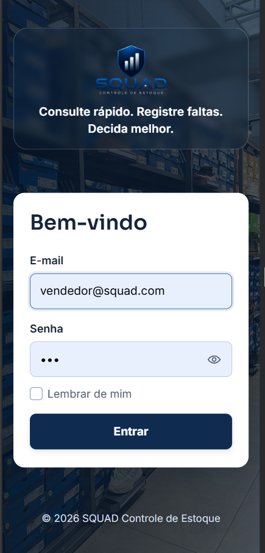

  **Mobile — destino pós-login (complementar, seção 5.1):** [Captura — `/Estoque/Consulta` com sessão `VENDEDOR`](../../evidencias/s2-qa-035/complemento-login-vendedor-pos-login-destino-mobile-21a4f46e.png) — `POST /Account/Login` → `302`; `GET /Estoque/Consulta` → `200`.

### VNP-02 — Login do Lojista com direcionamento ao perfil

- **Requisito:** RF-01, RF-02, UC-01
- **Forma de execução:** Manual
- **Nível:** E2E
- **Pré-condição:** USR-LOJ-01 ativo; sessão limpa.
- **Passos:**
  1. Abrir `/Account/Login` em Desktop e em Mobile.
  2. Informar as credenciais de USR-LOJ-01.
  3. Selecionar "Entrar".
  4. Observar a tela de destino e o status HTTP.
- **Entrada:** e-mail e senha de USR-LOJ-01.
- **Saída esperada:** autenticação como `LOJISTA` e redirecionamento para `/Produtos`.
- **Resultado obtido:** autenticação realizada e redirecionamento para `/Produtos` em Desktop e Mobile. Confirmado na execução complementar (seção 5.1): o envio do formulário de login respondeu `302` e a página de destino `/Produtos` foi servida com `200`, em Desktop e em Mobile, com a captura da tela de destino anexada.
- **Status de execução:** Aprovado
- **Evidência:**

  **Desktop:**

  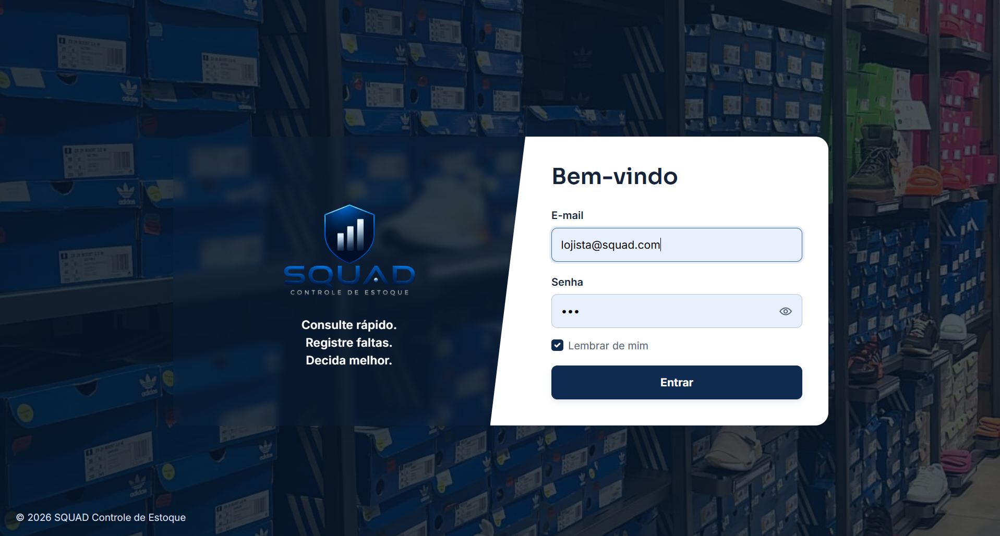

  **Desktop — destino pós-login (complementar, seção 5.1):** [Captura — `/Produtos` com sessão `LOJISTA`](../../evidencias/s2-qa-035/complemento-login-lojista-pos-login-destino-desktop-018acf50.png) — `POST /Account/Login` → `302`; `GET /Produtos` → `200`.

  **Mobile:**

  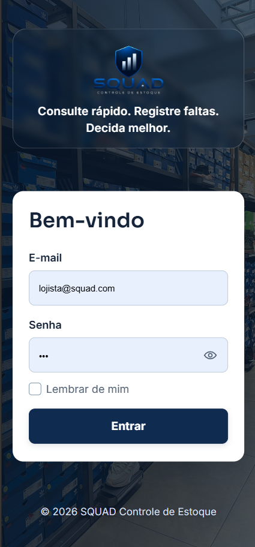

  **Mobile — destino pós-login (complementar, seção 5.1):** [Captura — `/Produtos` com sessão `LOJISTA`](../../evidencias/s2-qa-035/complemento-login-lojista-pos-login-destino-mobile-35ff951c.png) — `POST /Account/Login` → `302`; `GET /Produtos` → `200`.

### VNP-03 — Consulta do Vendedor: busca, status de estoque e desfechos

- **Requisito:** RF-13, RF-15, RF-16, UC-02, UC-03
- **Forma de execução:** Manual
- **Nível:** Aceite
- **Pré-condição:** USR-VEN-01 autenticado; massa de estoque com saldos 0, 1 e 2 ou maior.
- **Passos:**
  1. Acessar `/Estoque/Consulta` em Desktop e em Mobile.
  2. Buscar um modelo pelo campo "Buscar modelo...".
  3. Conferir as cores e os rótulos de cada tamanho.
  4. Conferir os botões de desfecho.
- **Entrada:** texto de busca de um modelo da massa; tamanhos com saldos 0, 1 e 2 ou maior.
- **Saída esperada:** saldo normal em verde (**Disponível**), saldo 1 em laranja (**Último par**), saldo 0 em cinza (**Indisponível**); desfechos **Vendeu**, **Não tinha** e **Desistiu**. No Mobile, exibição em cards com menu retrátil funcional.
- **Resultado obtido:** tela carregada e funcional no Desktop; layout responsivo carregado no Mobile.
- **Status de execução:** Aprovado
- **Evidência:**

  **Desktop:**

  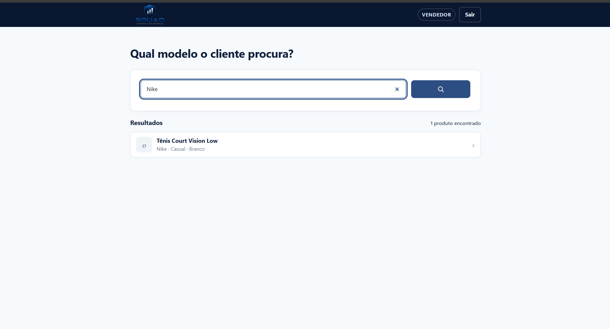

  **Mobile:**

  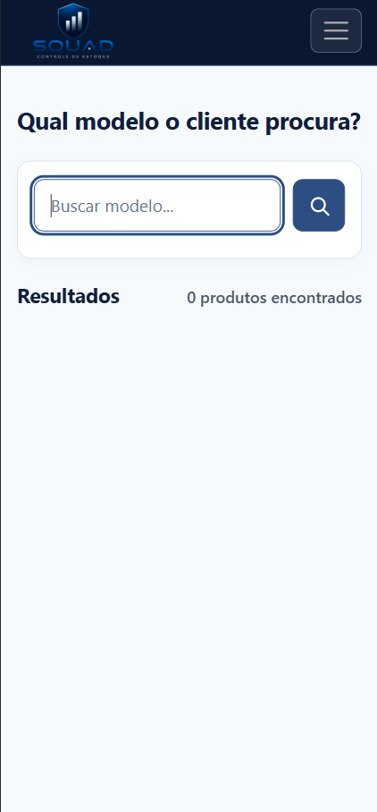

### VNP-04 — Vendedor bloqueado nas rotas administrativas

- **Requisito:** RF-02, RN-04; relacionado a CT-AUT-13
- **Forma de execução:** Manual
- **Nível:** E2E
- **Pré-condição:** USR-VEN-01 autenticado; aba Network aberta.
- **Passos:**
  1. Digitar na barra de endereço `/Produtos`, `/Produtos/Create`, `/Movimentacoes` e `/Movimentacoes/Ajuste`.
  2. Registrar o redirecionamento e o status HTTP de cada rota.
  3. Repetir em Desktop e em Mobile.
- **Entrada:** acesso direto por URL, sem uso do menu.
- **Saída esperada:** acesso negado, sem dados da rota protegida. O plano (CT-AUT-13) prevê `302` para Acesso Negado.
- **Resultado obtido:** nas quatro rotas, em Desktop e Mobile, o destino final exibido foi `/Account/AccessDenied?ReturnUrl=…`, com a página "Acesso Não Autorizado" e a sessão `VENDEDOR` ainda ativa no cabeçalho; nenhum dado protegido foi exibido. Na execução complementar (seção 5.1), o Desktop teve status HTTP registrado para as quatro rotas. No Mobile, o log registrou status apenas para `/Produtos` e `/Movimentacoes/Ajuste`; `/Produtos/Create` e `/Movimentacoes` têm somente captura da execução inicial, sem código de resposta no log:

  **Desktop — status HTTP registrados na execução complementar:**

  | Rota (perfil `VENDEDOR`) | Resposta à rota | Destino | Status do destino |
  |---|---|---|---|
  | `/Produtos` | `302` | `/Account/AccessDenied?ReturnUrl=%2FProdutos` | `200` |
  | `/Produtos/Create` | `302` | `/Account/AccessDenied?ReturnUrl=%2FProdutos%2FCreate` | `200` |
  | `/Movimentacoes` | `302` | `/Account/AccessDenied?ReturnUrl=%2FMovimentacoes` | `200` |
  | `/Movimentacoes/Ajuste` | `302` | `/Account/AccessDenied?ReturnUrl=%2FMovimentacoes%2FAjuste` | `200` |

  **Mobile — cobertura das rotas:**

  | Rota (perfil `VENDEDOR`) | Destino exibido | Status HTTP |
  |---|---|---|
  | `/Produtos` | `/Account/AccessDenied?ReturnUrl=%2FProdutos` | `302` → `200` |
  | `/Produtos/Create` | `/Account/AccessDenied?ReturnUrl=%2FProdutos%2FCreate` | não registrado (apenas captura) |
  | `/Movimentacoes` | `/Account/AccessDenied?ReturnUrl=%2FMovimentacoes` | não registrado (apenas captura) |
  | `/Movimentacoes/Ajuste` | `/Account/AccessDenied?ReturnUrl=%2FMovimentacoes%2FAjuste` | `302` → `200` |

  O comportamento observado corresponde ao previsto no plano (Acesso Negado), e não ao "redirecionamento para Login" registrado na versão anterior deste relatório; ver seção 13, item 3.
- **Status de execução:** Aprovado
- **Evidência:**

  **Desktop — `/Produtos`:**

  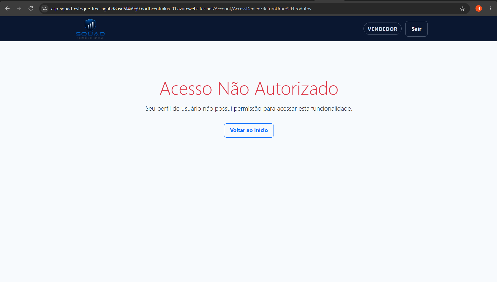

  **Desktop — `/Produtos/Create`:**

  

  **Desktop — `/Movimentacoes`:**

  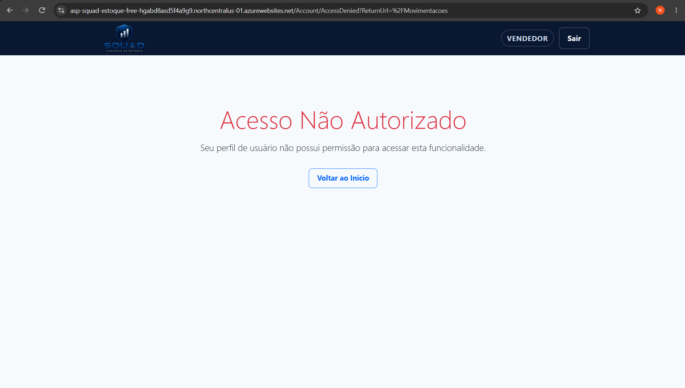

  **Desktop — `/Movimentacoes/Ajuste`:**

  

  **Desktop — capturas complementares com viewport 1920 × 1080 e status HTTP (seção 5.1):**

  - [`/Produtos` — `302` → `200`](../../evidencias/s2-qa-035/complemento-vendedor-bloqueado-produtos-desktop-60706ff3.png)
  - [`/Produtos/Create` — `302` → `200`](../../evidencias/s2-qa-035/complemento-vendedor-bloqueado-produtos-create-desktop-565d30d9.png)
  - [`/Movimentacoes` — `302` → `200`](../../evidencias/s2-qa-035/complemento-vendedor-bloqueado-movimentacoes-desktop-04663b28.png)
  - [`/Movimentacoes/Ajuste` — `302` → `200`](../../evidencias/s2-qa-035/complemento-vendedor-bloqueado-movimentacoes-ajuste-desktop-a92e66f1.png)

  **Mobile — `/Produtos`:**

  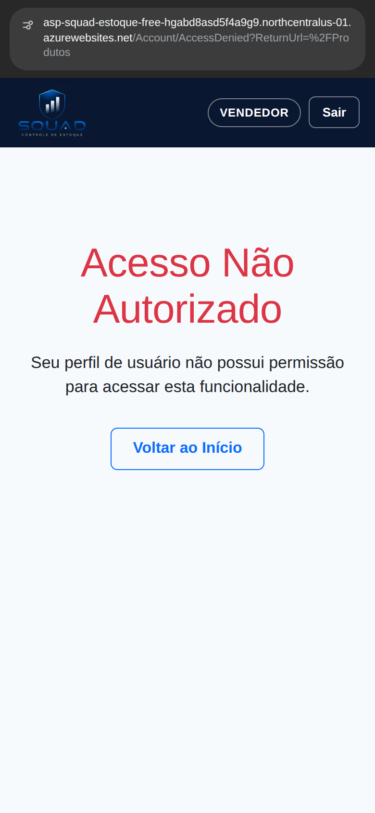

  **Mobile — `/Produtos/Create`:**

  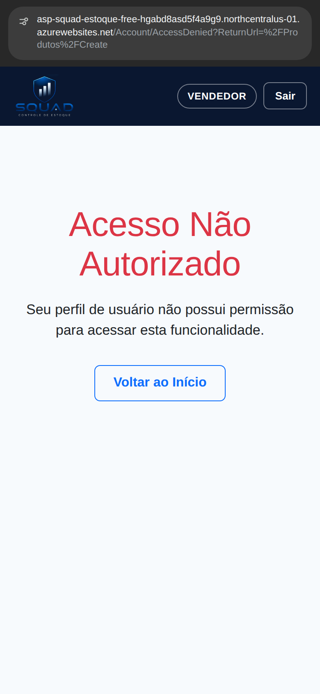

  **Mobile — `/Movimentacoes`:**

  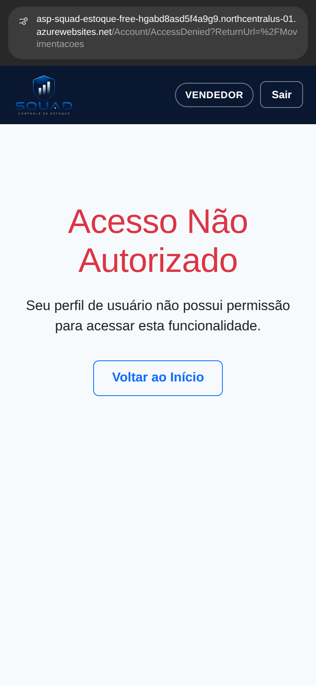

  **Mobile — `/Movimentacoes/Ajuste`:**

  

  **Mobile — capturas complementares com viewport 375 × 812 e status HTTP (seção 5.1):**

  - [`/Produtos` — `302` → `200`](../../evidencias/s2-qa-035/complemento-vendedor-bloqueado-produtos-mobile-ef1e75c2.png)
  - [`/Movimentacoes/Ajuste` — `302` → `200`](../../evidencias/s2-qa-035/complemento-vendedor-bloqueado-movimentacoes-ajuste-mobile-87dc946e.png)

### VNP-05 — Lojista acessa o Histórico de Rupturas

- **Requisito:** RF-02, RF-22; UC-12 _[confirmar no SRS]_
- **Forma de execução:** Manual
- **Nível:** Aceite
- **Pré-condição:** USR-LOJ-01 autenticado; registros de ruptura existentes.
- **Passos:**
  1. Autenticar com USR-LOJ-01.
  2. Selecionar "Histórico de rupturas" no menu superior (Desktop) e no menu retrátil (Mobile), que aponta para `/Rupturas`.
  3. Conferir a tela exibida e o status HTTP.
- **Entrada:** navegação pelo menu.
- **Saída esperada:** acesso permitido ao Lojista (`RupturasController` exige `LOJISTA`); histórico simples com modelo, numeração e quantidade de ocorrências; interface sem quebra de layout no Mobile.
- **Resultado obtido:** tela de Histórico de Rupturas acessada pelo Lojista em Desktop e Mobile, conforme capturas. A tela exibe modelo, numeração e quantidade de ocorrências, mas **a contagem não foi conferida contra os registros de ruptura** e o status HTTP de `/Rupturas` não foi registrado no log da execução complementar. Como a saída esperada inclui a quantidade de ocorrências, o caso não é considerado concluído.
- **Status de execução:** Em execução — acesso e interface evidenciados por captura; pendentes a conferência da contagem de ocorrências contra os registros e o registro do status HTTP.
- **Pendência:** confrontar as ocorrências exibidas na captura com os registros persistidos e registrar o status HTTP de `/Rupturas`.
- **Evidência:**

  **Desktop — Histórico de Rupturas:**

  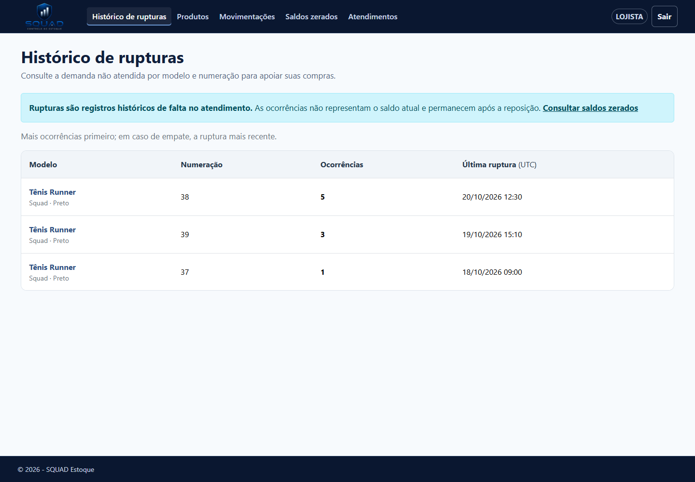

  **Mobile — Histórico de Rupturas:**

  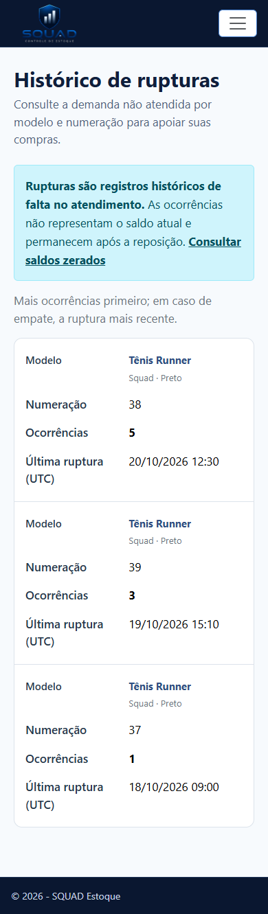

### VNP-06 — Menu por perfil

- **Requisito:** RF-02, RF-03 _[confirmar no SRS]_
- **Forma de execução:** Manual
- **Nível:** Aceite
- **Pré-condição:** USR-VEN-01 e USR-LOJ-01 ativos; sessão limpa.
- **Passos:**
  1. Autenticar com cada perfil.
  2. Conferir o menu superior (Desktop) e o menu retrátil (Mobile).
- **Entrada:** navegação pelo menu.
- **Saída esperada:** Vendedor vê apenas as opções do seu perfil; Lojista vê "Histórico de rupturas", "Produtos", "Movimentações", "Saldos zerados", "Atendimentos" e "Sair", além da identificação do perfil (conforme `_Layout.cshtml` na `main` atual).
- **Resultado obtido:** menu restrito para o Vendedor e menu do Lojista exibido em Desktop e Mobile. As capturas do commit testado (`729b28f`) mostram no menu do Lojista apenas "Produtos", "Movimentações" e "Atendimentos"; os itens "Histórico de rupturas" e "Saldos zerados" existem no layout atual da `main` mas não aparecem nessas capturas — ver seção 13, item 7.
- **Status de execução:** Aprovado
- **Evidência:**

  **Desktop — menu do Vendedor:**

  

  **Desktop — menu do Lojista:**

  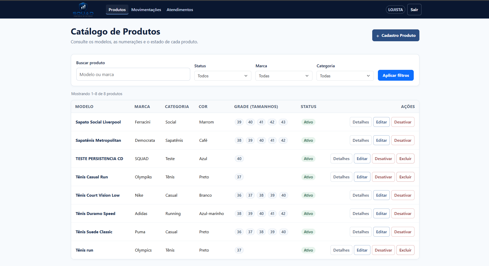

  **Mobile — menu do Vendedor:**

  

  **Mobile — menu do Lojista:**

  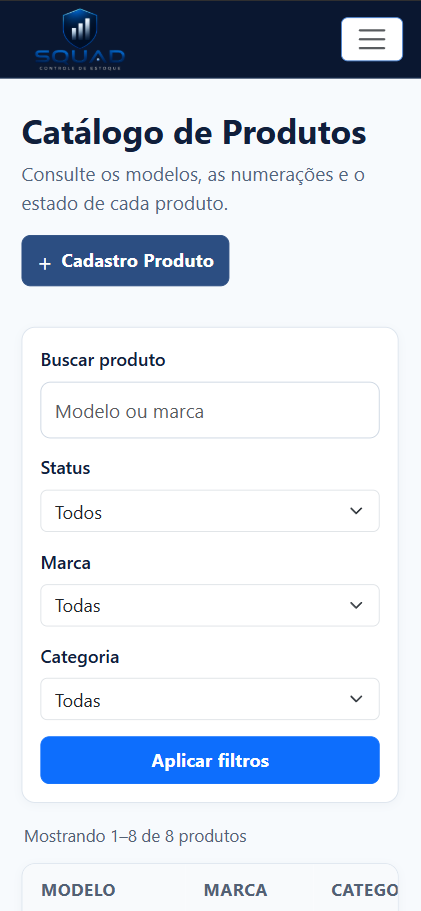

### VNP-07 — Catálogo de Produtos com filtros combinados

- **Requisito:** RF-02; RF-05; RF-06; RF-07
- **Forma de execução:** Manual
- **Nível:** Aceite
- **Pré-condição:** USR-LOJ-01 autenticado; catálogo com produtos ativos e inativos.
- **Passos:**
  1. Acessar `/Produtos` em Desktop e em Mobile.
  2. Combinar busca por texto, status (Ativos, Inativos ou Todos), marca e categoria.
  3. Conferir as colunas da tabela e as ações.
- **Entrada:** combinações de filtros.
- **Saída esperada:** tabela filtrada conforme os critérios, com modelo, marca, categoria, cor, grade de tamanhos, status e ações de detalhes, edição e desativação; botão "+ Novo produto" disponível.
- **Resultado obtido:** interface carregada, filtros operacionais e comportamento responsivo em Desktop e Mobile.
- **Status de execução:** Aprovado
- **Evidência:**

  **Desktop:**

  

  **Mobile:**

  

### VNP-08 — Cadastro de produto com geração automática de SKUs

- **Requisito:** RF-05, RF-06, RF-07, UC-07, UC-08
- **Forma de execução:** Manual
- **Nível:** E2E
- **Pré-condição:** USR-LOJ-01 autenticado.
- **Passos:**
  1. Selecionar "+ Novo produto" (`/Produtos/Create`).
  2. Informar nome do modelo, marca, categoria e cor.
  3. Informar os tamanhos separados por vírgula.
  4. Salvar e conferir a grade criada.
- **Entrada:** tamanhos `37, 38, 39, 40, 41`.
- **Saída esperada:** produto cadastrado e uma opção de SKU por numeração, cada uma com saldo inicial zero.
- **Resultado obtido:** formulário aberto e operável em Desktop e Mobile. A execução complementar (seção 5.1) cadastrou o produto "Tênis Evidência S2QA035" com as numerações `37, 38, 39, 40, 41` informadas no campo "Outras numerações". No **Desktop**, o salvamento respondeu `302` para `/Produtos/Details/{id}`, servida com `200`, e a captura da tela de detalhes mostra a **grade de numerações com as cinco opções de SKU geradas, cada uma com saldo zero** (estado "Indisponível"). No **Mobile**, a captura complementar mostra a mesma grade; o log da execução complementar não contém respostas HTTP do fluxo Mobile, portanto os status não são afirmados para esse viewport. Ver seção 13, item 13, sobre o comportamento do campo "Outras numerações".
- **Status de execução:** Aprovado
- **Evidência:**

  **Desktop:**

  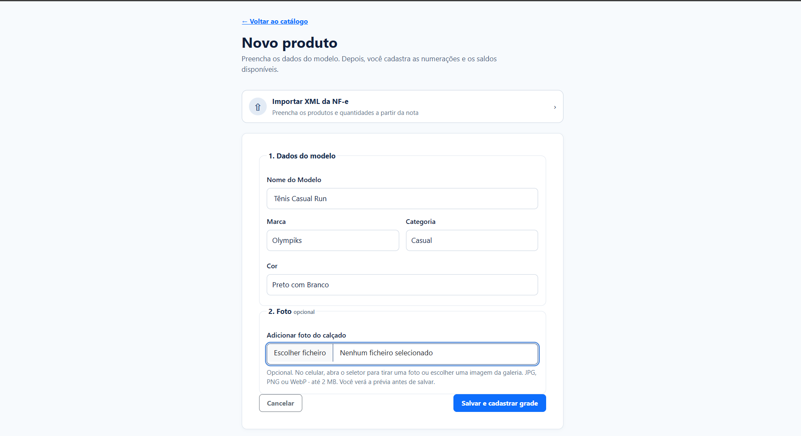

  **Desktop — grade após salvar (complementar, seção 5.1):** [Captura — detalhes do produto com grade 37–41 e saldo zero](../../evidencias/s2-qa-035/complemento-cadastro-produto-grade-pos-salvar-desktop-9f11479c.png) — `POST /Produtos/Create` → `302`; `POST /Produtos/AdicionarNumeracoes/{id}` → `302`; `GET /Produtos/Details/{id}` → `200`.

  **Mobile:**

  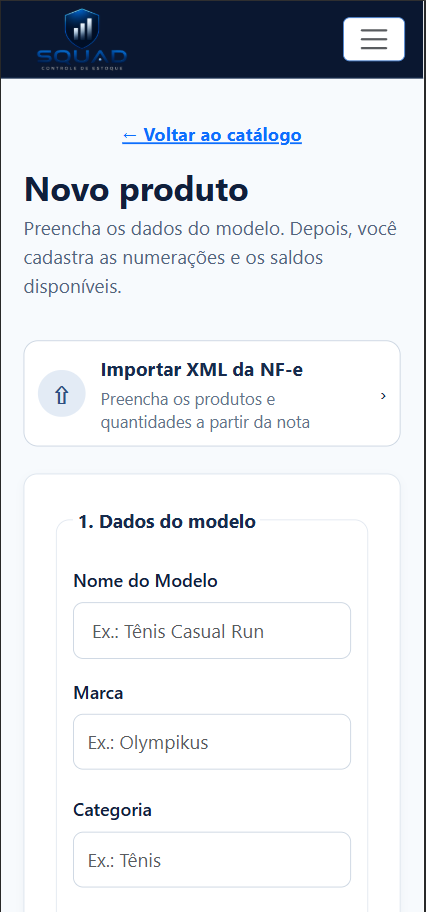

  **Mobile — grade após salvar (complementar, seção 5.1):** [Captura — detalhes do produto com grade 37–41 e saldo zero](../../evidencias/s2-qa-035/complemento-cadastro-produto-grade-pos-salvar-mobile-602c76c8.png) — captura evidencia a grade; status HTTP do fluxo Mobile não registrado no log.

### VNP-09 — Histórico de movimentações (auditoria)

- **Requisito:** RF-10; RF-23; RF-02 e RNF-07
- **Forma de execução:** Manual
- **Nível:** Aceite
- **Pré-condição:** USR-LOJ-01 autenticado; movimentações existentes.
- **Passos:**
  1. Acessar `/Movimentacoes` em Desktop e em Mobile.
  2. Aplicar filtros de modelo, tipo, período e responsável.
  3. Conferir as colunas da tabela e as ações rápidas.
- **Entrada:** combinações dos filtros.
- **Saída esperada:** tabela com data e hora, produto, tamanho, tipo, quantidade, usuário responsável e justificativa; ações "Nova entrada", "Nova saída" e "Ajuste manual"; no Mobile, sem quebra de layout.
- **Resultado obtido:** tabela e filtros carregados; layout ajustado em Desktop e Mobile.
- **Status de execução:** Aprovado
- **Evidência:**

  **Desktop:**

  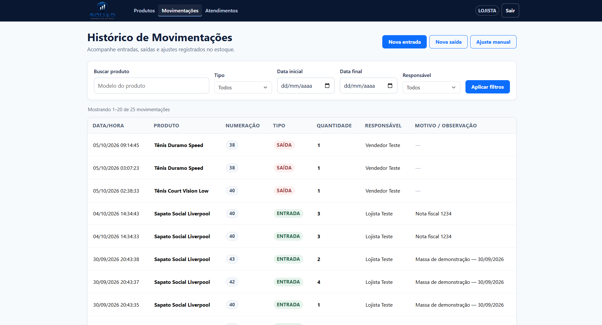

  **Mobile:**

  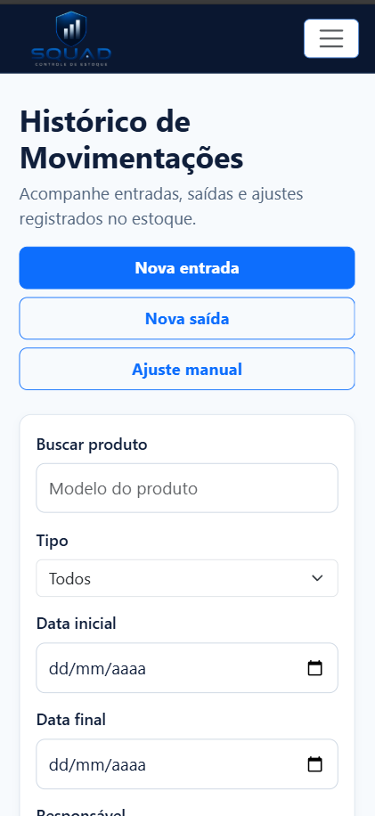

### VNP-10 — Registro de entrada de estoque

- **Requisito:** RF-09, RF-10, UC-09
- **Forma de execução:** Manual
- **Nível:** Aceite
- **Pré-condição:** USR-LOJ-01 autenticado; produto com grade cadastrada.
- **Passos:**
  1. Selecionar "Nova entrada" (`/Movimentacoes/Entrada`).
  2. Selecionar produto e numeração e conferir o saldo atual exibido.
  3. Conferir o campo de quantidade e a observação opcional.
- **Entrada:** produto, numeração, quantidade em pares inteiros positivos e observação (como número ou chave da nota fiscal).
- **Saída esperada:** formulário exibido com seleção de produto e numeração, saldo atual, quantidade positiva e observação opcional.
- **Resultado obtido:** formulário exibido e operável em Desktop e Mobile. O saldo final após o envio não foi registrado neste caso.
- **Status de execução:** Aprovado
- **Evidência:**

  **Desktop:**

  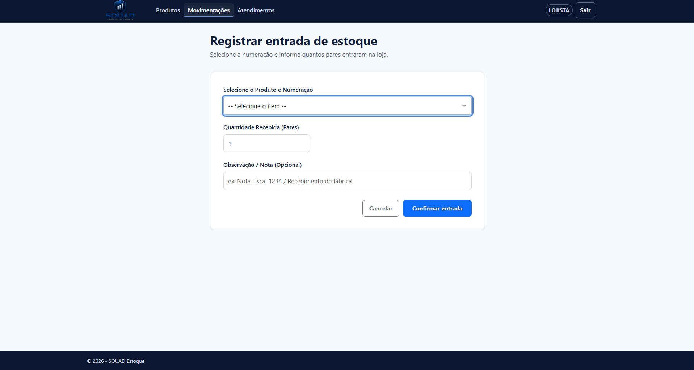

  **Mobile:**

  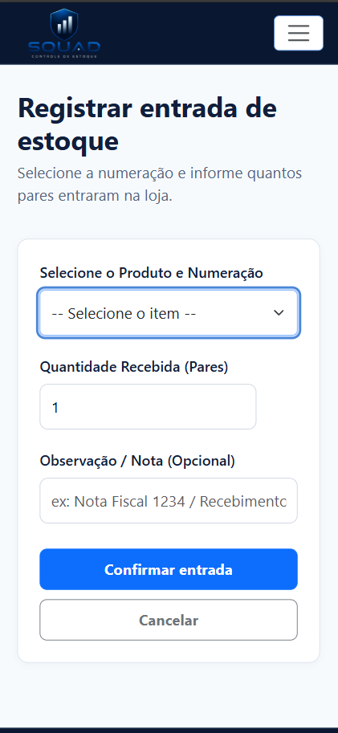

### VNP-11 — Registro de saída de estoque

- **Requisito:** RF-11, RN-02
- **Forma de execução:** Manual
- **Nível:** Aceite
- **Pré-condição:** USR-LOJ-01 autenticado; SKU com saldo disponível.
- **Passos:**
  1. Selecionar "Nova saída" (`/Movimentacoes/Saida`).
  2. Conferir a seleção de produto e numeração, a quantidade e a observação.
- **Entrada:** produto, numeração, quantidade e observação.
- **Saída esperada:** formulário de baixa de estoque exibido, com observação opcional.
- **Resultado obtido:** formulário exibido e operável em Desktop e Mobile. O bloqueio de saída acima do saldo não foi exercitado neste relatório.
- **Status de execução:** Aprovado
- **Evidência:**

  **Desktop:**

  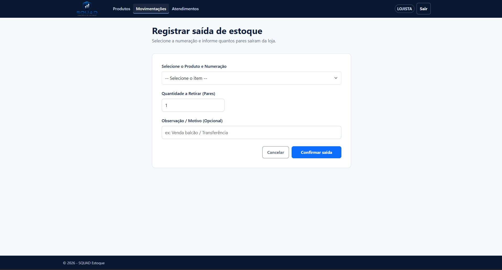

  **Mobile:**

  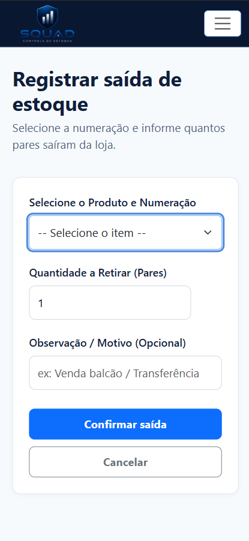

### VNP-12 — Ajuste manual com justificativa obrigatória

- **Requisito:** RF-23, UC-10, RN-02; relacionado a UT-11
- **Forma de execução:** Manual
- **Nível:** Aceite
- **Pré-condição:** USR-LOJ-01 autenticado.
- **Passos:**
  1. Selecionar "Ajuste manual" (`/Movimentacoes/Ajuste`).
  2. Tentar salvar com justificativa vazia ou curta.
  3. Informar uma justificativa válida e salvar.
- **Entrada:** justificativa vazia, curta e válida.
- **Saída esperada:** justificativa inválida é rejeitada; o mínimo de cinco caracteres foi confirmado no código (`[MinLength(5)]` em `AjusteEstoqueViewModel.cs` e validação equivalente em `MovimentacoesController.Ajuste`).
- **Resultado obtido:** no **Desktop**, executado na íntegra na execução complementar (seção 5.1). Com justificativa **vazia**, o formulário exibiu a mensagem "O motivo do ajuste é obrigatório." e não enviou a requisição. Com justificativa **curta** (`ab`), exibiu "O motivo deve conter pelo menos 5 caracteres." e não enviou a requisição. Com justificativa **válida** ("Recontagem de inventário complementar S2-QA-035"), o envio respondeu `302` e a movimentação foi registrada, com redirecionamento para `/Produtos/Details/{id}` servido com `200`. No **Mobile**, foi exercitada apenas a justificativa **curta**, com a mesma mensagem; justificativa vazia e justificativa válida não foram executadas nesse viewport, e o log não contém respostas HTTP do fluxo Mobile. As mensagens de validação são as mesmas declaradas no cliente e no servidor.
- **Status de execução:** Aprovado
- **Evidência:**

  **Desktop:**

  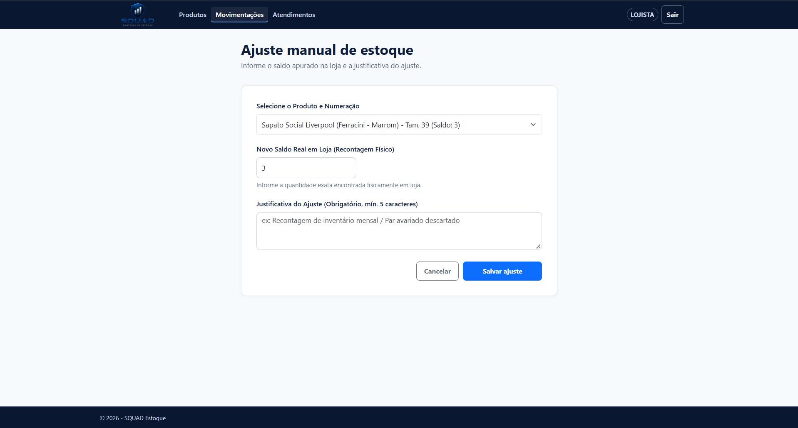

  **Desktop — complementar (seção 5.1):**

  - [Justificativa vazia — mensagem de validação](../../evidencias/s2-qa-035/complemento-ajuste-justificativa-vazia-validacao-desktop-8eae5140.png)
  - [Justificativa curta — mensagem de validação](../../evidencias/s2-qa-035/complemento-ajuste-justificativa-curta-validacao-desktop-8878f99a.png)
  - [Justificativa válida — sucesso (`302` → `200 /Produtos/Details/{id}`)](../../evidencias/s2-qa-035/complemento-ajuste-justificativa-valida-sucesso-desktop-131d4f0f.png)

  **Mobile:**

  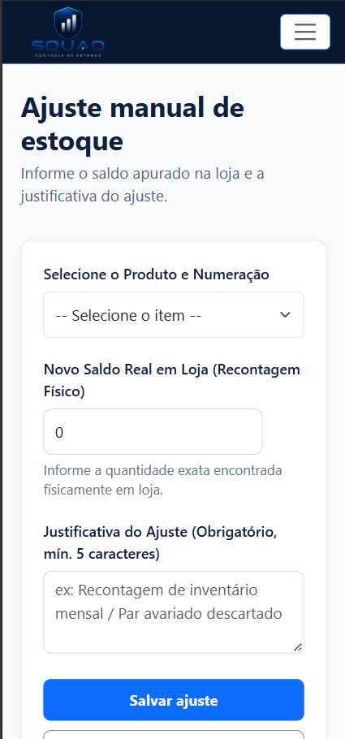

  **Mobile — complementar (seção 5.1):** [Justificativa curta — mensagem de validação](../../evidencias/s2-qa-035/complemento-ajuste-justificativa-curta-validacao-mobile-df4d9f05.png)

### VNP-13 — Anônimo bloqueado nas rotas protegidas

- **Requisito:** RF-02; relacionado a CT-AUT-09 e CT-AUT-10
- **Forma de execução:** Manual
- **Nível:** E2E
- **Pré-condição:** sessão sem autenticação; aba Network aberta.
- **Passos:**
  1. Digitar `/Estoque/Consulta`, `/Produtos`, `/Produtos/Create` e `/Movimentacoes`.
  2. Registrar o redirecionamento e o status HTTP de cada rota.
  3. Repetir em Desktop e em Mobile.
- **Entrada:** acesso direto por URL.
- **Saída esperada:** `302` para `/Account/Login` com `ReturnUrl`; nenhum conteúdo protegido.
- **Resultado obtido:** redirecionamento para `/Account/Login` com `ReturnUrl` em todas as rotas, em Desktop e Mobile, sem exibição de conteúdo protegido. Na execução complementar (seção 5.1), o Desktop teve status HTTP registrado para as quatro rotas. No Mobile, o log registrou status apenas para `/Estoque/Consulta` e `/Produtos`; `/Produtos/Create` e `/Movimentacoes` têm somente captura da execução inicial, sem código de resposta no log:

  **Desktop — status HTTP registrados na execução complementar:**

  | Rota (anônimo) | Resposta à rota | Destino | Status do destino |
  |---|---|---|---|
  | `/Estoque/Consulta` | `302` | `/Account/Login?ReturnUrl=%2FEstoque%2FConsulta` | `200` |
  | `/Produtos` | `302` | `/Account/Login?ReturnUrl=%2FProdutos` | `200` |
  | `/Produtos/Create` | `302` | `/Account/Login?ReturnUrl=%2FProdutos%2FCreate` | `200` |
  | `/Movimentacoes` | `302` | `/Account/Login?ReturnUrl=%2FMovimentacoes` | `200` |

  **Mobile — cobertura das rotas:**

  | Rota (anônimo) | Destino exibido | Status HTTP |
  |---|---|---|
  | `/Estoque/Consulta` | `/Account/Login?ReturnUrl=%2FEstoque%2FConsulta` | `302` → `200` |
  | `/Produtos` | `/Account/Login?ReturnUrl=%2FProdutos` | `302` → `200` |
  | `/Produtos/Create` | `/Account/Login?ReturnUrl=%2FProdutos%2FCreate` | não registrado (apenas captura) |
  | `/Movimentacoes` | `/Account/Login?ReturnUrl=%2FMovimentacoes` | não registrado (apenas captura) |

- **Status de execução:** Aprovado
- **Evidência:**

  **Desktop — `/Estoque/Consulta`:**

  

  **Desktop — `/Produtos`:**

  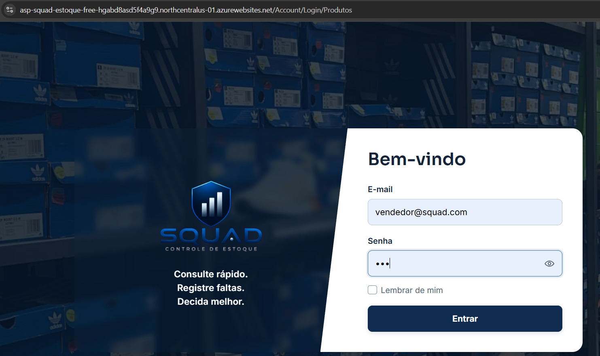

  **Desktop — `/Produtos/Create`:**

  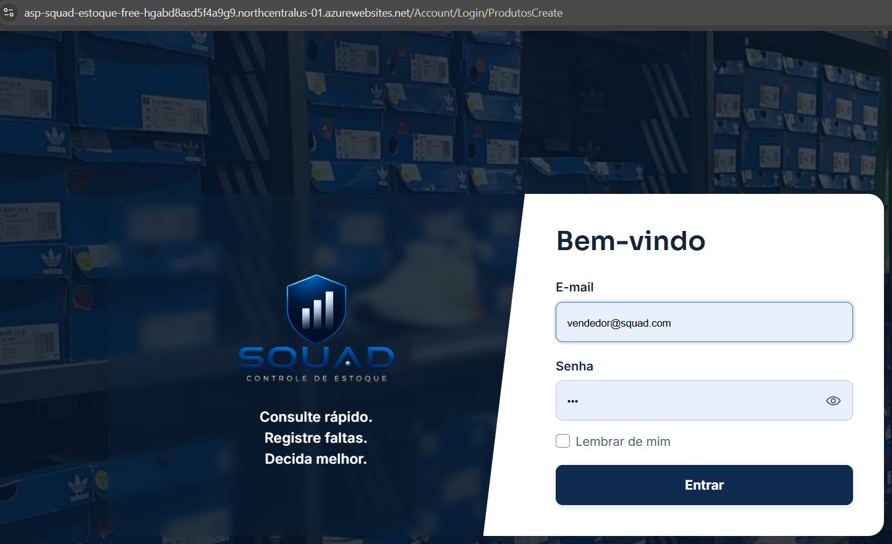

  **Desktop — `/Movimentacoes`:**

  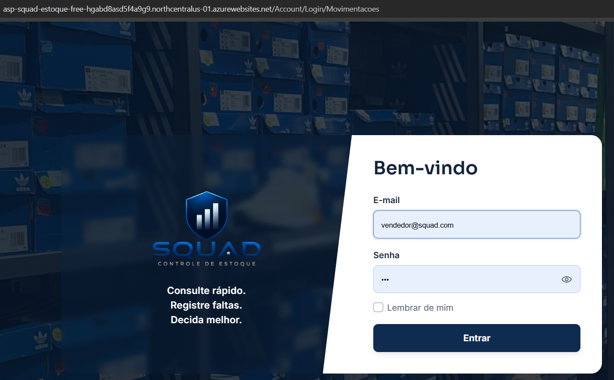

  **Desktop — captura complementar com viewport 1920 × 1080 e status HTTP (seção 5.1):** [Tela de login após redirecionamento — `302` → `200`](../../evidencias/s2-qa-035/complemento-anonimo-bloqueado-destino-desktop-590411b5.png)

  **Mobile — `/Estoque/Consulta`:**

  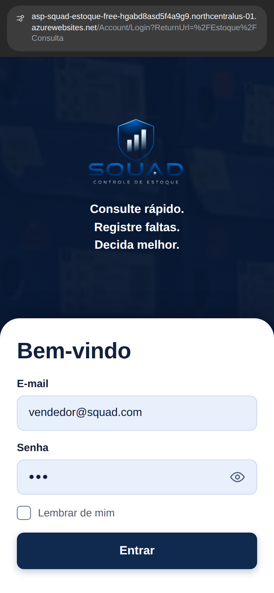

  **Mobile — `/Produtos`:**

  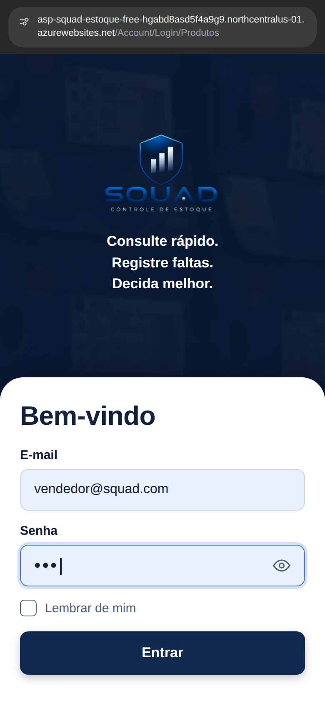

  **Mobile — `/Produtos/Create`:**

  

  **Mobile — `/Movimentacoes`:**

  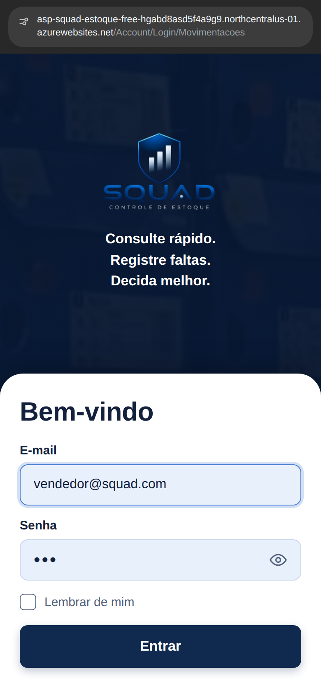

  **Mobile — captura complementar com viewport 375 × 812 e status HTTP (seção 5.1):** [Tela de login após redirecionamento — `302` → `200`](../../evidencias/s2-qa-035/complemento-anonimo-bloqueado-destino-mobile-3e1533bf.png)

### VNP-14 — Lojista acessa a consulta de estoque

- **Requisito:** RF-02
- **Forma de execução:** Manual
- **Nível:** Aceite
- **Pré-condição:** USR-LOJ-01 autenticado.
- **Passos:**
  1. Acessar `/Estoque/Consulta` em Desktop e em Mobile.
- **Entrada:** acesso por URL.
- **Saída esperada:** a rota exige `VENDEDOR` (`[Authorize(Roles = "VENDEDOR")]` em `EstoqueController`), portanto o LOJISTA deve ser **negado** com destino a `/Account/AccessDenied?ReturnUrl=%2FEstoque%2FConsulta`.
- **Resultado obtido:** executado na execução complementar (seção 5.1), com sessão `LOJISTA` genuína, em Desktop e Mobile: o acesso a `/Estoque/Consulta` respondeu `302` e o destino `/Account/AccessDenied?ReturnUrl=%2FEstoque%2FConsulta` foi servido com `200`, exibindo a página "Acesso Não Autorizado" com a sessão `LOJISTA` identificada no cabeçalho; nenhum conteúdo da consulta foi exibido. Este resultado confirma o previsto e corrige a versão anterior deste relatório, cujas capturas rotuladas "Lojista" mostravam a sessão `VENDEDOR` (seção 13, item 9).
- **Status de execução:** Aprovado
- **Evidência:**

  Capturas da execução inicial abaixo são do perfil `VENDEDOR` e **não confirmam** este caso:

  **Desktop:**

  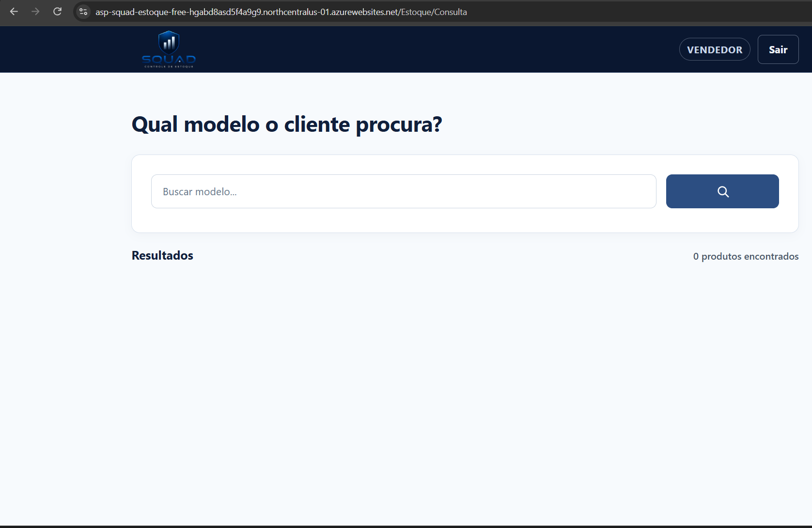

  **Mobile:**

  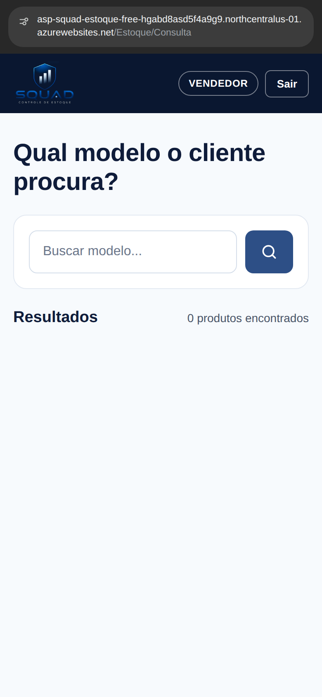

  **Capturas complementares da sessão `LOJISTA` (seção 5.1):**

  - [Desktop — `/Estoque/Consulta` negado ao LOJISTA (`302` → `200 /Account/AccessDenied`)](../../evidencias/s2-qa-035/complemento-lojista-negado-estoque-consulta-desktop-c1649bd0.png)
  - [Mobile — `/Estoque/Consulta` negado ao LOJISTA (`302` → `200 /Account/AccessDenied`)](../../evidencias/s2-qa-035/complemento-lojista-negado-estoque-consulta-mobile-1d74ee1c.png)

### VNP-15 — Encerramento de sessão

- **Requisito:** RF-03; relacionado a CT-AUT-18
- **Forma de execução:** Manual
- **Nível:** E2E
- **Pré-condição:** USR-VEN-01 e USR-LOJ-01, cada um autenticado.
- **Passos:**
  1. Selecionar "Sair" (`/Account/Logout`).
  2. Tentar reabrir uma rota protegida pelo botão Voltar e por URL.
- **Entrada:** logout e nova tentativa de acesso.
- **Saída esperada:** sessão encerrada, retorno a `/Account/Login` e nova exigência de autenticação nas rotas protegidas.
- **Resultado obtido:** executado na execução complementar (seção 5.1), com cobertura de ambos os perfis: o Logout respondeu `302` e a tela de login foi servida com `200` (Lojista em Desktop, Vendedor em Mobile). A nova tentativa de acesso por URL após o logout (`/Produtos` em Desktop; `/Estoque/Consulta` em Mobile) foi redirecionada com `302` para `/Account/Login?ReturnUrl=…`, servida com `200` — ou seja, a sessão foi destruída e a autenticação foi exigida novamente, em Desktop e Mobile.
- **Status de execução:** Aprovado
- **Evidência:**

  **Desktop:**

  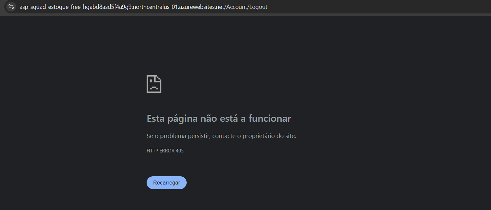

  **Desktop — complementar (seção 5.1):**

  - [Destino após Logout do Lojista — `302 /Account/Logout` → `200 /Account/Login`](../../evidencias/s2-qa-035/complemento-logout-lojista-destino-desktop-b39b9ed5.png)
  - [Nova tentativa por URL após logout — `302` → `200 /Account/Login?ReturnUrl=%2FProdutos`](../../evidencias/s2-qa-035/complemento-apos-logout-tentativa-produtos-desktop-e7d4b9d7.png)

  **Mobile — complementar (seção 5.1):**

  - [Destino após Logout do Vendedor — `302 /Account/Logout` → `200 /Account/Login`](../../evidencias/s2-qa-035/complemento-logout-vendedor-destino-mobile-bc6ae245.png)
  - [Nova tentativa por URL após logout — `302` → `200 /Account/Login?ReturnUrl=%2FEstoque%2FConsulta`](../../evidencias/s2-qa-035/complemento-apos-logout-tentativa-consulta-mobile-b6f31584.png)

## 9. Matriz resumo

| ID | Cenário | Perfil | Requisito | Status de execução |
|---|---|---|---|---|
| VNP-01 | Login e direcionamento | Vendedor | RF-01, RF-02 | Aprovado |
| VNP-02 | Login e direcionamento | Lojista | RF-01, RF-02 | Aprovado |
| VNP-03 | Consulta, status e desfechos | Vendedor | RF-13, RF-15, RF-16 | Aprovado |
| VNP-04 | Bloqueio das rotas administrativas | Vendedor | RF-02, RN-04 | Aprovado |
| VNP-05 | Histórico de Rupturas | Lojista | RF-02, RF-22 | Em execução |
| VNP-06 | Menu por perfil | Vendedor e Lojista | RF-02, RF-03 | Aprovado |
| VNP-07 | Catálogo e filtros | Lojista | RF-02, RF-05 a RF-07 | Aprovado |
| VNP-08 | Cadastro e grade de SKUs | Lojista | RF-05 a RF-07 | Aprovado |
| VNP-09 | Histórico de movimentações | Lojista | RF-10, RF-23 | Aprovado |
| VNP-10 | Entrada de estoque | Lojista | RF-09, RF-10 | Aprovado |
| VNP-11 | Saída de estoque | Lojista | RF-11, RN-02 | Aprovado |
| VNP-12 | Ajuste manual | Lojista | RF-23 | Aprovado |
| VNP-13 | Bloqueio de anônimo | Anônimo | RF-02 | Aprovado |
| VNP-14 | Consulta pelo Lojista | Lojista | RF-02 | Aprovado |
| VNP-15 | Logout | Vendedor e Lojista | RF-03 | Aprovado |

**Totais:** 15 casos; 14 Aprovados; 0 Reprovados; 0 Não executados; 1 Em execução (VNP-05). Os casos VNP-12, VNP-14 e VNP-15, antes "Não executado", foram concluídos na execução complementar (seção 5.1) com evidências de captura e de status HTTP. O VNP-05 permanece em execução porque a contagem de ocorrências não foi conferida contra os registros, embora o acesso e a interface estejam evidenciados por captura.

## 10. Evidências

### 10.1 Desktop (1920 × 1080 px)

- **Login do Vendedor:**
  

- **Login do Lojista:**
  

- **Consulta do Vendedor:**
  

- **Histórico de Rupturas:**
  

- **Catálogo de Produtos:**
  

- **Cadastro de Novo Produto:**
  

- **Histórico de Movimentações:**
  

- **Registrar Nova Entrada:**
  

- **Registrar Nova Saída:**
  

- **Ajuste Manual:**
  

- **Acesso Negado - Produtos:**
  

- **Acesso Negado - Produtos Create:**
  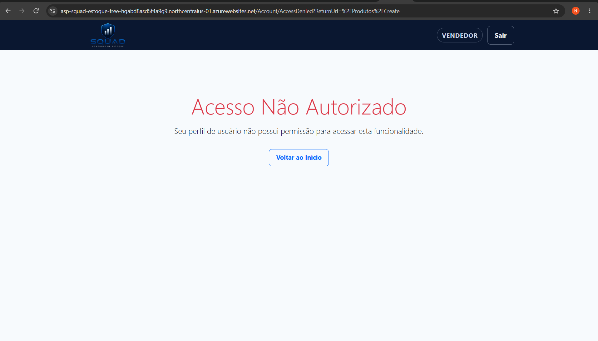

- **Acesso Negado - Movimentações:**
  

- **Acesso Negado - Movimentações Ajuste:**
  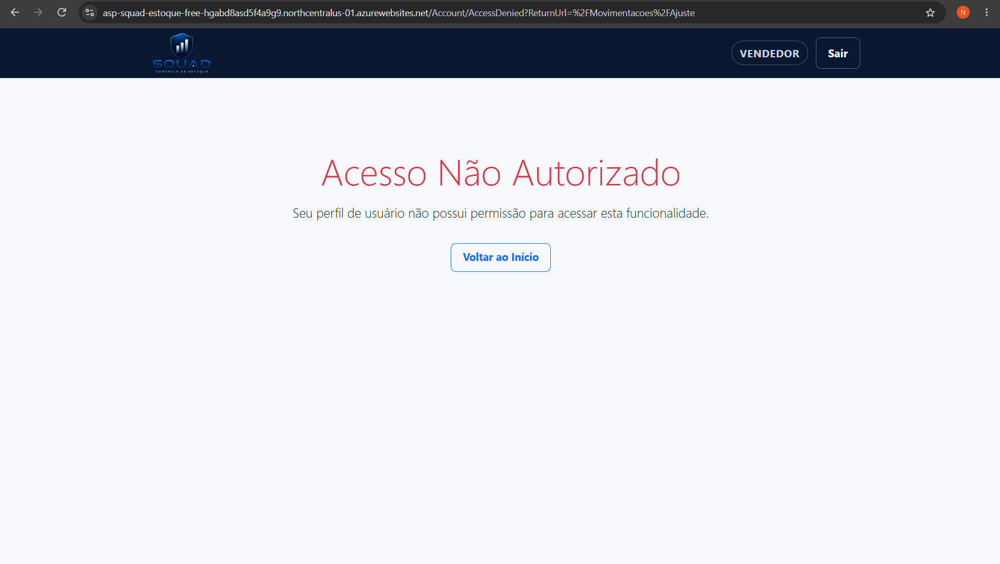

- **Anônimo - Estoque/Consulta:**
  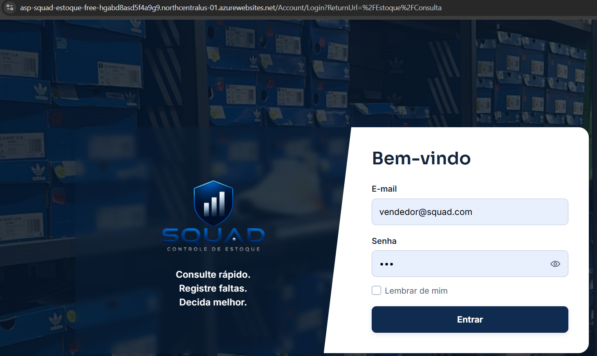

- **Anônimo - Produtos:**
  

- **Anônimo - ProdutosCreate:**
  

- **Anônimo - Movimentações:**
  

### 10.2 Mobile (viewport emulado, 375 × 812 px)

- **Login do Vendedor – Mobile:**
  

- **Login do Lojista – Mobile:**
  

- **Consulta do Vendedor – Mobile:**
  

- **Histórico de Rupturas – Mobile:**
  

- **Catálogo de Produtos – Mobile:**
  

- **Cadastro do Novo Produto – Mobile:**
  

- **Histórico de Movimentações – Mobile:**
  

- **Registrar Nova Entrada – Mobile:**
  

- **Registrar Nova Saída – Mobile:**
  

- **Ajuste Manual – Mobile:**
  

- **Acesso Negado - Produtos Mobile:**
  

- **Acesso Negado - Produtos Create Mobile:**
  

- **Acesso Negado - Movimentações Mobile:**
  

- **Acesso Negado - Movimentações Ajuste Mobile:**
  

- **Anônimo - Estoque/Consulta Mobile:**
  

- **Anônimo - Produtos Mobile:**
  

- **Anônimo - ProdutosCreate Mobile:**
  

- **Anônimo - Movimentações Mobile:**
  

### 10.3 Rastreabilidade das evidências de acesso e sessão

Capturas indexadas por caso. A coluna "Status HTTP" traz os códigos registrados na execução complementar (seção 5.1), extraídos de `http-log-complementar-s2-qa-035.json`; "n/r" significa que a rota não foi reexecutada na complementar e o status permanece não registrado. As linhas de VNP-04 e VNP-13 referem-se ao **Desktop**; no Mobile, o log cobre apenas as rotas indicadas nas tabelas dos respectivos casos. **VNP-03 e VNP-05 a VNP-11 não têm status HTTP registrado** — a evidência desses casos é exclusivamente visual.

| Caso | Perfil | Rota ou ação | Captura | Status HTTP |
|---|---|---|---|---|
| VNP-01 | Vendedor | `POST /Account/Login` → `/Estoque/Consulta` | [Captura complementar](../../evidencias/s2-qa-035/complemento-login-vendedor-pos-login-destino-desktop-f337250b.png) | `302` → `200` |
| VNP-02 | Lojista | `POST /Account/Login` → `/Produtos` | [Captura complementar](../../evidencias/s2-qa-035/complemento-login-lojista-pos-login-destino-desktop-018acf50.png) | `302` → `200` |
| VNP-04 | Vendedor | `/Produtos` | [Captura complementar](../../evidencias/s2-qa-035/complemento-vendedor-bloqueado-produtos-desktop-60706ff3.png) | `302` → `200` (`/Account/AccessDenied`) |
| VNP-04 | Vendedor | `/Produtos/Create` | [Captura complementar](../../evidencias/s2-qa-035/complemento-vendedor-bloqueado-produtos-create-desktop-565d30d9.png) | `302` → `200` (`/Account/AccessDenied`) |
| VNP-04 | Vendedor | `/Movimentacoes` | [Captura complementar](../../evidencias/s2-qa-035/complemento-vendedor-bloqueado-movimentacoes-desktop-04663b28.png) | `302` → `200` (`/Account/AccessDenied`) |
| VNP-04 | Vendedor | `/Movimentacoes/Ajuste` | [Captura complementar](../../evidencias/s2-qa-035/complemento-vendedor-bloqueado-movimentacoes-ajuste-desktop-a92e66f1.png) | `302` → `200` (`/Account/AccessDenied`) |
| VNP-08 | Lojista | `POST /Produtos/AdicionarNumeracoes/{id}` → `/Produtos/Details/{id}` | [Captura complementar](../../evidencias/s2-qa-035/complemento-cadastro-produto-grade-pos-salvar-desktop-9f11479c.png) | `302` → `200` |
| VNP-12 | Lojista | `POST /Movimentacoes/Ajuste` (justificativa válida) | [Captura complementar](../../evidencias/s2-qa-035/complemento-ajuste-justificativa-valida-sucesso-desktop-131d4f0f.png) | `302` → `200` (`/Produtos/Details/{id}`) |
| VNP-12 | Lojista | Justificativa vazia e curta (validação do formulário) | [Captura vazia](../../evidencias/s2-qa-035/complemento-ajuste-justificativa-vazia-validacao-desktop-8eae5140.png) · [Captura curta](../../evidencias/s2-qa-035/complemento-ajuste-justificativa-curta-validacao-desktop-8878f99a.png) | n/r (bloqueio no cliente, sem requisição) |
| VNP-13 | Anônimo | `/Estoque/Consulta` | [Captura complementar](../../evidencias/s2-qa-035/complemento-anonimo-bloqueado-destino-desktop-590411b5.png) | `302` → `200` (`/Account/Login`) |
| VNP-13 | Anônimo | `/Produtos` | (mesma tela de login) | `302` → `200` (`/Account/Login`) |
| VNP-13 | Anônimo | `/Produtos/Create` | (mesma tela de login) | `302` → `200` (`/Account/Login`) |
| VNP-13 | Anônimo | `/Movimentacoes` | (mesma tela de login) | `302` → `200` (`/Account/Login`) |
| VNP-14 | Lojista | `/Estoque/Consulta` | [Captura complementar](../../evidencias/s2-qa-035/complemento-lojista-negado-estoque-consulta-desktop-c1649bd0.png) | `302` → `200` (`/Account/AccessDenied`) |
| VNP-15 | Lojista (D) e Vendedor (M) | `POST /Account/Logout` | [Captura D](../../evidencias/s2-qa-035/complemento-logout-lojista-destino-desktop-b39b9ed5.png) · [Captura M](../../evidencias/s2-qa-035/complemento-logout-vendedor-destino-mobile-bc6ae245.png) | `302` → `200` (`/Account/Login`) |
| VNP-15 | Lojista (D) e Vendedor (M) | Nova tentativa por URL após logout | [Captura D](../../evidencias/s2-qa-035/complemento-apos-logout-tentativa-produtos-desktop-e7d4b9d7.png) · [Captura M](../../evidencias/s2-qa-035/complemento-apos-logout-tentativa-consulta-mobile-b6f31584.png) | `302` → `200` (`/Account/Login?ReturnUrl=…`) |

## 11. Cobertura de cenários

| Categoria (plano, seção 8.4) | Cobertura neste relatório |
|---|---|
| Positivos | VNP-01 a VNP-03 e VNP-06 a VNP-11 aprovados; VNP-05 em execução (acesso e interface evidenciados, contagem de ocorrências pendente); VNP-12 aprovado no Desktop, com mensagens de validação e sucesso do ajuste, e com validação curta no Mobile |
| Permissão e segurança | VNP-04, VNP-06 e VNP-13 aprovados com capturas; em VNP-04 e VNP-13, os status HTTP foram registrados para as quatro rotas no Desktop e de forma parcial no Mobile. VNP-14 aprovado com sessão `LOJISTA` genuína e status HTTP; VNP-15 aprovado com logout e nova tentativa de acesso em Desktop e Mobile |
| Responsividade e compatibilidade | Todos os casos têm captura em D e M; compatibilidade do navegador coberta por Chrome e Edge; a execução complementar usou exclusivamente Chromium (Playwright) |
| Negativos e limites | Cobertos por CT-AUT-04 a CT-AUT-06, UT-05 e UT-11. A justificativa inválida do ajuste (VNP-12) foi exercitada e evidenciada na execução complementar; os demais casos negativos não foram exercitados neste relatório |
| Desempenho e concorrência | Não aplicável a esta validação de navegação |

## 12. Limitações

- O Mobile foi validado em viewport emulado, não em dispositivo físico. Toque, teclado virtual e renderização nativa não foram cobertos. A execução inicial usou o emulador do Chrome DevTools (390 × 844 px); a complementar usou emulação real do Playwright (375 × 812 px, `deviceScaleFactor` 2).
- A execução inicial cobriu Chrome e Edge (v118.0), em Windows 11 Pro e macOS Ventura; a execução complementar (seção 5.1) usou exclusivamente Chromium via Playwright em Windows, sobre aplicação local.
- Apenas duas resoluções foram testadas. As dimensões das capturas iniciais (Mobile entre 390 e 435 px de largura; Desktop do Histórico de Rupturas e do acesso anônimo abaixo de 1920 px) não coincidem exatamente com as resoluções declaradas na seção 5; as capturas complementares (`complemento-*`) têm viewport exata.
- O status HTTP dos casos VNP-03, VNP-05 a VNP-11 (rotas de consulta e formulários permitidos) não foi registrado; a execução complementar concentrou-se nos itens solicitados na revisão (VNP-01, VNP-02, VNP-04, VNP-08, VNP-12, VNP-13, VNP-14 e VNP-15). Nesses casos, a aprovação (exceto VNP-05) apoia-se exclusivamente nas capturas de tela, conforme a seção 7.
- A execução complementar foi feita contra a aplicação em ambiente local (seção 5.1), com massa de dados de demonstração, e não contra o App Service em produção usado na execução inicial; os comportamentos validados (autorização, redirecionamentos e validações) são os mesmos conferidos no código.
- Os fluxos de entrada e saída (VNP-10 e VNP-11) não tiveram o saldo final conferido neste relatório; o ajuste (VNP-12) teve o redirecionamento de sucesso confirmado, sem conferência de saldo.
- O Histórico de Rupturas (VNP-05) não teve a contagem de ocorrências conferida contra os registros; por isso o caso permanece **Em execução**, embora o acesso e a interface estejam evidenciados por captura.
- A validação é manual (execução inicial), complementada por script Playwright reproduzindo os mesmos passos; não há suíte de automação versionada para este cartão.

## 13. Divergências e itens a confirmar

1. **Rotas:** resolvido. O relato original usava `/login`, `/consulta`, `/produtos`, `/produtos/novo` e `/movimentacoes/entrada`; este relatório usa os caminhos MVC conferidos no código (`/Account/Login`, `/Estoque/Consulta`, `/Produtos/Create`, `/Movimentacoes/Entrada`) e a rota do Histórico de Rupturas é `/Rupturas` (seção 6).
2. **Destino pós-login:** resolvido no código. O plano informa que a implementação atual redireciona ambos os perfis para `/`, mas `AccountController.Login` direciona `VENDEDOR` para `/Estoque/Consulta` e `LOJISTA` para `/Produtos` — comportamento registrado em VNP-01 e VNP-02. O plano está desatualizado neste ponto.
3. **Vendedor em rota proibida:** resolvido. As capturas mostram URL final `/Account/AccessDenied?ReturnUrl=…` com a página "Acesso Não Autorizado", ou seja, o comportamento corresponde ao previsto no plano (CT-AUT-13) e não ao "redirecionamento para Login" da versão anterior deste relatório. Os status HTTP (`302` na rota, `200` no destino) foram registrados na execução complementar (seção 5.1, VNP-04).
4. **Justificativa do ajuste:** resolvido. O mínimo de cinco caracteres está no código: `[MinLength(5)]` em `AjusteEstoqueViewModel.cs` e validação equivalente em `MovimentacoesController.Ajuste`. As mensagens de validação foram evidenciadas no VNP-12 (execução complementar).
5. **Requisitos:** conferir no SRS os RF e UC do catálogo (VNP-07), do histórico de movimentações (VNP-09), do Histórico de Rupturas (VNP-05, RF-22 e UC-12) e do menu (VNP-06, RF-02 e RF-03).
6. **Data e commit:** o cabeçalho registra a execução inicial (12/10/2026, commit `729b28f`) e a execução complementar (27/10/2026, `main` `8c94b36`, conferida depois em `95199c4` — seção 5.2); o registro anterior do PR trazia `20/10/2026` como data única. O cabeçalho foi ajustado para distinguir as duas execuções.
7. **Menu do Lojista:** as capturas do commit testado (`729b28f`) mostram apenas "Produtos", "Movimentações" e "Atendimentos"; `_Layout.cshtml` da `main` atual — usada na execução complementar — inclui ainda "Histórico de rupturas" e "Saldos zerados", conforme visível nas capturas complementares (ex.: `complemento-login-lojista-pos-login-destino-desktop-018acf50.png`). Divergência esclarecida pela reexecução sobre a `main`.
8. **Ambiente:** o PR declarava "ambiente local com SQLite", mas as capturas iniciais mostram o endereço `asp-squad-estoque-free-hgabd8asd5f4a9g9.northcentralus-01.azurewebsites.net`. A seção 5 foi mantida para a execução inicial (App Service) e a seção 5.1 documenta a execução complementar em ambiente local, conforme a intenção original do PR.
9. **Viewports:** as capturas iniciais Mobile têm 390 × 844 px, 780 × 1688 px (2x de 390 × 844) ou entre 415 e 435 px de largura, e a do Histórico de Rupturas tem 390 × 1331 px (captura de página inteira), contra os 375 × 812 px declarados na seção 5. A execução complementar usou viewport exata de 375 × 812 px (DSF 2, largura de 750 px nas capturas) e 1920 × 1080 px em Desktop; as seções 5.1 e 12 deixam a distinção explícita.
10. **Evidências duplicadas e anexos removidos:** as capturas de acesso negado e de anônimo aparecem com identificadores diferentes na seção 8 e na seção 10. Dois anexos originais do PR (`c0542fa6-…` e `82e4a9bd-…0d8e8ae8caf0`) retornam **404** no GitHub e foram substituídos, nesta versão, pelas capturas equivalentes já versionadas em `docs/09-testing/evidencias/s2-qa-035/`. Confirmar se são o mesmo material.
11. **VNP-08:** resolvido. A grade de SKUs após salvar foi capturada na execução complementar (`complemento-cadastro-produto-grade-pos-salvar-desktop-9f11479c.png` e `-mobile-602c76c8.png`), com as numerações 37–41 e saldo zero em cada SKU.
12. **Status alterados:** VNP-12, VNP-14 e VNP-15 estavam como **Não executado** e voltaram a **Aprovado** após a execução complementar (seção 5.1), com evidências de captura e de status HTTP anexadas, conforme a regra da seção 7.
13. **Campo "Outras numerações" (observação da execução complementar):** em `AdicionarNumeracoesViewModel`, a propriedade `NumeracoesExtras` é `string` não-anulável em projeto com `<Nullable>enable</Nullable>`, o que gera `[Required]` implícito no servidor. Um envio apenas com as caixas de numeração marcadas (sem preencher "Outras numerações") é rejeitado silenciosamente: o servidor responde `200` com o formulário novamente, sem mensagem no resumo de validação `ModelOnly` da view. Pelo fluxo normal (botão "Salvar grade"), a validação client-side bloqueia o envio e exibe o aviso de campo obrigatório. No caso VNP-08, a execução preencheu o campo "Outras numerações" com `37, 38, 39, 40, 41` e o salvamento foi concluído com sucesso. Registrar card separado para avaliar a remoção do `[Required]` implícito, já que a regra de negócio aceita cadastrar a grade apenas pelas caixas de seleção.
14. **Cobertura desigual entre Desktop e Mobile (correção de superdeclaração):** a execução complementar não repetiu todas as rotas em ambos os viewports. VNP-04 e VNP-13 têm status HTTP das quatro rotas no Desktop, mas no Mobile o log cobre duas rotas em cada caso; VNP-08 e VNP-12 têm status HTTP apenas no Desktop (no Mobile, VNP-08 tem captura da grade e VNP-12 tem apenas a validação curta). O relatório agora declara essa diferença em cada caso e na seção 12, em vez de afirmar cobertura uniforme.
15. **VNP-05:** o status passou de **Aprovado** para **Em execução**. O acesso e a interface foram evidenciados por captura em Desktop e Mobile, mas a saída esperada inclui a quantidade de ocorrências, que não foi conferida contra os registros; o status HTTP de `/Rupturas` também não foi coletado. A conclusão exige confrontar a contagem exibida com os registros persistidos.
16. **Critério de VNP-14 (correção explícita):** o título do cenário diz "Lojista acessa a consulta de estoque", mas o [inventário de telas](../../../05-ux/inventario-telas-e-mapa-navegacao.md) atribui a consulta de produtos ao **VENDEDOR** (VEN-02) e o `EstoqueController` exige `[Authorize(Roles = "VENDEDOR")]`. O critério correto não é o acesso permitido, e sim a **negativa ao LOJISTA**, com destino a `/Account/AccessDenied`. O caso foi executado e aprovado com esse critério, comprovado por status HTTP (`302` → `200`) e captura com sessão `LOJISTA` genuína (seções 6.1 e 8). A versão anterior do relatório usava capturas rotuladas "Lojista" que na verdade mostravam sessão `VENDEDOR`; essas imagens foram mantidas apenas como registro histórico e estão identificadas como não comprobatórias.
17. **Conferência contra a `main` atual (`95199c4`):** conforme a seção 5.2, o diff em relação a `8c94b36` não altera autorização, rotas ou destinos de login. A conferência foi estática, sem nova execução HTTP, e está declarada como tal.
